# Cell types

This chapter describes every cell type in detail: what it does, which signal channels it reads and writes, its properties and the simulation parameters that affect it. It also covers the constructor, which is not a cell type of its own but can be added to almost any cell.

## How cell types work

Every cell runs in cycles of 6 time steps. In each cycle, the neural network of the cell first calculates the eight channels of its signal. Then the cell type executes its function. It reads channels of the signal as inputs and may overwrite some channels with its results. The connected cells see these results in the next cycle. See [Neural networks and signals](neural-networks.md) for the details of this process.

Some general rules apply to all cell types:

- Cells under construction stay inactive until the last cell of their gene is built, see [How construction works](#how-construction-works). Dying cells stay active until they disintegrate.
- Many cell types act only when they are **triggered**. A cell is triggered when the absolute value of channel #0 is at least **0.1**. Some cell types additionally distinguish between positive and negative values.
- Cell types that need a direction, such as sensors, muscles and communicators, use the **front direction** of the creature. It is defined in the genome and passed from the head cell to all other cells. Such cells only work once the front direction has reached them. The head cell sends it out every 100 time steps, so newly built cells can stay idle for up to about 100 time steps.
- Channel values range from -2 to 2. Directions are encoded as a value between -1 and 1, which corresponds to an angle between -180 and 180 degrees relative to the front direction.
- Energy that a cell type spends, for example for an attack, is not lost. It is emitted as energy particles next to the cell or at a radiation source. With a **Backflow** above 0, part of it can flow back into the external energy pool instead. See [Energy](energy.md#where-released-energy-goes).

| Cell type | Triggered by | Reads | Writes |
| --- | --- | --- | --- |
| [Base](#base) | | | |
| [Depot](#depot) | #0 | #0 | |
| [Sensor](#sensor) | every cycle or #0 | #0 | #0 to #3 |
| [Generator](#generator) | every cycle | #0 (with **Additive**) | #0 |
| [Attacker](#attacker) | #0 | | #2 |
| [Injector](#injector) | #0 | | #1 |
| [Muscle](#muscle) | every cycle | #0, #1 | |
| [Defender](#defender) | passive | | |
| [Reconnector](#reconnector) | #0 | #0 | #2 |
| [Detonator](#detonator) | #0 | | |
| [Digestor](#digestor) | every cycle | | |
| [Memory](#memory) | every cycle | #0 and all channels | selected channels |
| [Communicator](#communicator) | #0 (sender) | all channels | all channels (receiver) |
| [Void](#void) | after construction | | |
| [Constructor](#constructor) | interval or #0 | #0 | #4 |

## Base

A base cell has no special function. Only its neural network is executed. Base cells are the right choice for the structure of a body, for relaying signals and for processing signals with their neural network.

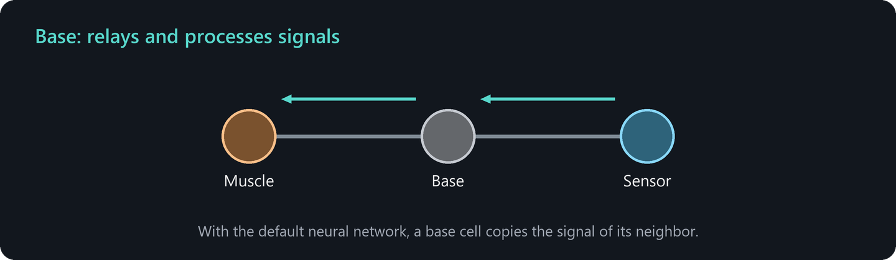

**Example:** A chain of base cells between a sensor and the muscles carries the sensor signal unchanged, because the default neural network copies the signal of the cell at its first connection. In a gene, the first connection of each node points to the next node. Signals therefore flow from the last node towards node 0, so the sensor has to sit at a later node than the muscles. A base cell with a modified neural network can, for example, invert a direction or combine two signals.

## Depot

A depot stores usable energy and gives it back on demand. It lets the creature store energy for later.

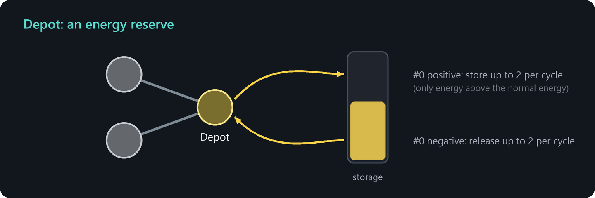

### Signals

| Channel | Meaning |
| --- | --- |
| #0 (input) | Greater than or equal to 0.1: store energy. Less than or equal to -0.1: release energy. |

When storing, the depot moves up to 2 energy units per cycle from its usable energy into the storage, but only the part above the normal energy. When releasing, it moves up to 2 units per cycle from the storage back into its usable energy. The stored energy is part of the creature: attackers can steal it, and it can be released to feed the other cells through the energy sharing between connected cells.

### Properties

| Property | Meaning |
| --- | --- |
| Max energy for storage | Maximum usable energy that the depot can hold. The simulation limits the storage to 500 regardless of this value. The inspection window calls it **Storage limit**. |
| Stored usable energy | The usable energy that is currently stored (inspection only). |

**Example:** Use the **Energy** telemetry input of the neural network: store when the energy of the cell is high and release when it is low.

## Sensor

A sensor scans the surroundings and reports the closest match. It is the eye of a creature.

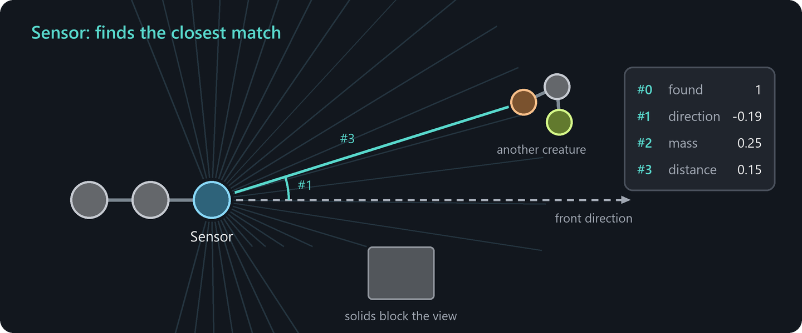

### Signals

| Channel | Meaning |
| --- | --- |
| #0 (input) | Triggers a scan if **Auto trigger** is off and the absolute value is at least 0.1. A negative value switches to tracking, see below. |
| #0 (output) | 1 if something was found, otherwise 0. |
| #1 (output) | Direction of the match relative to the front direction, between -1 and 1. |
| #2 (output) | Mass of the match. For energy particles: the total energy of the particles in a square of 8 by 8 units, divided by 64 and capped at 1. For free cells: the number of free cells in such a square divided by 64. For solids: always 1. For creatures: a value that grows with their size (0.5 for 30 cells, 0.75 for 60 cells, 1 for 120 cells or more). |
| #3 (output) | Distance of the match: 1 means very close, 0 means 256 units or farther. |

Channels #1 to #3 are only written when something is found.

### How scanning works

The sensor sends 64 scan rays in all directions and reports the closest match. Solids block the rays, so creatures cannot see through rocks and walls. Connections of the same creature that are close to the sensor block the rays as well. A sensor in the middle of a body therefore sees less than a sensor at the edge.

If channel #0 is negative and the last scan found something, the sensor does not scan all around but only searches a square of 64 by 64 units around the previous match. This is useful for keeping track of a moving target. In *Detect solid* mode, the sensor always scans all around.

### Modes

| Mode | Detects |
| --- | --- |
| Detect energy | Concentrations of energy particles with at least the **Min density**. |
| Detect solid | Solid objects. |
| Detect free cell | Concentrations of free cells with at least the **Min density**, optionally restricted to colors. |
| Detect creature | Cells of other creatures, optionally restricted by size, color and lineage. |

### Properties

| Property | Meaning |
| --- | --- |
| Auto trigger | Scan in every cycle. Otherwise channel #0 triggers the scan. |
| Tag for attackers | Attacker cells of the same creature may attack the creatures that this sensor detects in *Detect creature* mode. These are the match and up to 3 further matching creatures near it. Within these creatures, only cells whose color is selected in **Restrict to colors** can be attacked. If several sensors of the creature tag the same target, the selected colors of all of them apply. Only the scan of the current cycle counts. |
| Min range, Max range | Only matches between these distances are detected. |
| Min density | For energy and free cells: the required density. For free cells, it lies between 0 and 1. For energy, it is the energy per area, which can exceed 1, so values above 1 only find dense clouds of energy. A mutation of this value limits it to the range from 0 to 1. |
| Restrict to colors | Only objects with one of the selected colors are detected. |
| Min creature cells, Max creature cells | For creatures: limits for the number of cells of the target creature. |
| Restrict to lineage | For creatures: only related creatures, only foreign creatures or no restriction. |

**Parameter:** the **Radius** in the *Cell type: Sensor* group limits the range of all sensors (255 by default).

**Example:** A sensor at the last node of a gene and muscles in *Direct movement* mode at the nodes before it create a creature that moves towards what the sensor detects. The muscles read the found flag from channel #0 as strength and the direction from channel #1. This design is built step by step in [Your first creature](first-creature.md).

## Generator

A generator produces a periodic signal in channel #0, like a heartbeat or a clock.

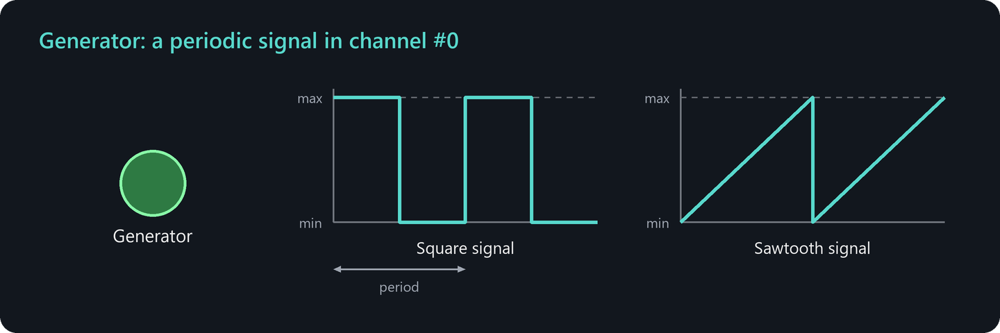

### Signals

| Channel | Meaning |
| --- | --- |
| #0 (output) | The generated value. |

### Properties

| Property | Meaning |
| --- | --- |
| Mode | *Square signal*: the maximum value during the first half of the period, the minimum value during the second half. *Sawtooth signal*: rises linearly from the minimum to the maximum value over the period. |
| Period | Length of one period in time steps. The generator advances by 6 time steps per cycle, so a period of 6 gives a constant value. Use a multiple of 6 that is at least 12. Among these, only multiples of 12 split a square signal into two equal halves. |
| Min value, Max value | The two levels of the signal, between -2 and 2. |
| Time offset | Shifts the phase by this number of time steps. |
| Additive | Adds the value to channel #0 instead of replacing it. |

**Example:** A square signal with a minimum value of 0 that feeds a memory cell in *Signal recorder* mode triggers a recording at regular intervals if **Read only** is switched off. With a negative minimum value, such as the default of -1, the negative half of the signal also starts playbacks. If the minimum and maximum values are equal, the generator produces a constant signal, which is a simple way to activate muscles permanently.

## Attacker

An attacker steals energy from free cells or from cells of other creatures. It is the mouth or the weapon of a creature.

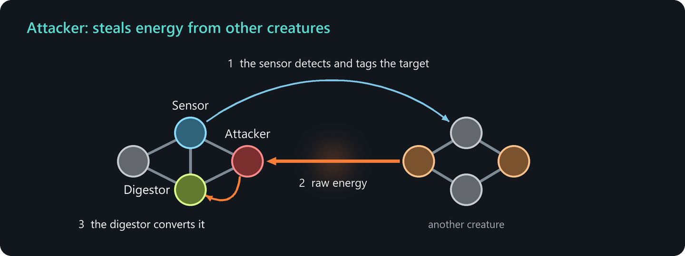

### Signals

| Channel | Meaning |
| --- | --- |
| #0 (input) | Triggers an attack if the absolute value is at least 0.1. |
| #2 (output) | Success: the stolen energy divided by 10, between 0 and 1. It is only written when the attacker is triggered and its raw energy is below 2. Otherwise the channel keeps the value of the neural network. |

### How attacks work

An attack hits all suitable targets within the **Attack radius**. A target is skipped if the straight line between the attacker and the target crosses a connection of the attacker's own creature or of an object that belongs to no creature, such as a rock wall. Connections of other creatures do not protect a target.

The stolen energy is added to the **raw energy** of the attacker. Raw energy is not usable directly. It flows into directly connected **digestor** cells, which convert it. An attacker without a directly connected digestor therefore gains no usable energy. An attacker only attacks again when its raw energy has dropped below 2.

The amount of energy depends on several factors:

- **Attack strength** sets the fraction of the energy of the target that is stolen per time step.
- The **Food chain color matrix** scales the amount depending on the colors of the attacker and the target.
- **Defender** cells in *Anti-attacker* mode reduce the amount if the target is such a defender or is directly connected to one, see [Defender](#defender).
- **Same lineage protection** reduces attacks on related creatures and **Size protection** reduces attacks on larger creatures.

Each attack attempt costs the amount set by **Energy cost**. This energy is emitted as energy particles. An attacker does not attack if this would bring its usable energy below the minimum energy.

### Modes

| Mode | Targets |
| --- | --- |
| Free cell | Free cells, optionally restricted to colors. |
| Creature | Cells of other creatures. Only creatures that a sensor of the same creature has detected and tagged in the current cycle are attacked, see **Tag for attackers** of the sensor. Within such a creature, only cells whose color is selected in **Restrict to colors** of at least one tagging sensor are attacked. A creature never attacks its own offspring. |

**Parameters:** the *Cell type: Attacker* group with **Energy cost**, **Food chain color matrix**, **Attack strength**, **Same lineage protection**, **Size protection** and **Attack radius** (2 by default).

**Example:** A predator needs a sensor in *Detect creature* mode with **Tag for attackers** enabled, an attacker and a digestor connected to the attacker. The sensor has to scan in the same cycle in which the attacker is triggered, for example with **Auto trigger**. The sensor signal can trigger the attacker through channel #0.

## Injector

An injector infects a cell of another creature with its own genome, like a virus. The infected cell then builds the gene that the injector selects.

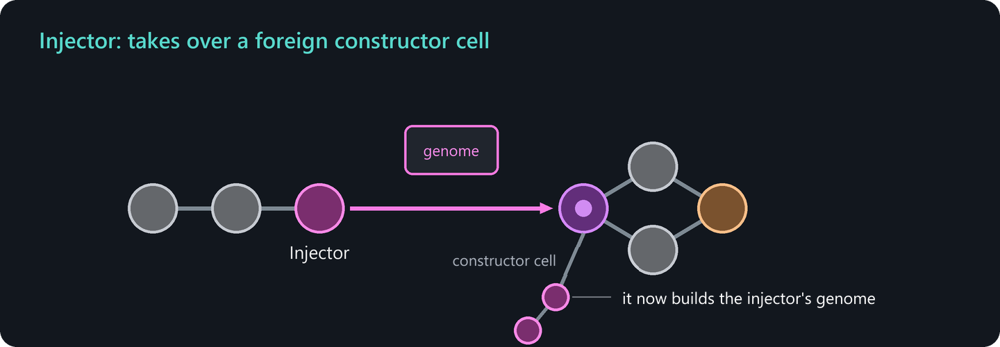

### Signals

| Channel | Meaning |
| --- | --- |
| #0 (input) | Triggers an injection if the absolute value is at least 0.1. |
| #1 (output) | 1 if an injection succeeded, otherwise 0. |

### How injection works

The injector looks for a cell of another creature within the **Injection radius** that has a constructor, is not static and whose genome has no **Resistance to injection**. Like an attack target, the cell must not be hidden behind connections, but only connections of objects within the **Attack radius** around the injector are checked. The injector takes the first such cell it finds, which is not necessarily the closest one. The target cell is taken over: it receives a copy of the genome of the injector, and its constructor starts anew with the gene given by the **Gene index** of the injector.

An injection costs the amount set by **Energy cost**, 250 by default. This energy is emitted as energy particles. Each defender in *Anti-injector* mode that is connected to the target makes the injection more expensive, see [Defender](#defender). The injector only acts if its usable energy stays above the minimum energy after paying.

### Properties

| Property | Meaning |
| --- | --- |
| Gene index | The gene of the injector genome that the infected cell builds. |

**Parameters:** the *Cell type: Injector* group with **Energy cost** and **Injection radius** (3 by default).

## Muscle

A muscle moves the creature. It can bend joints, stretch connections or accelerate itself directly.

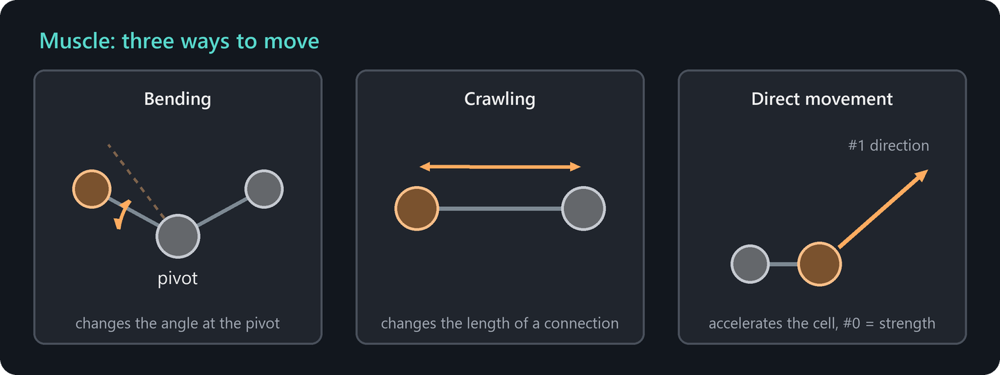

### Signals

| Channel | Meaning |
| --- | --- |
| #0 (input) | Activation, limited to -1 to 1. The absolute value sets the strength of the action. In the manual modes, the sign sets the direction. A negative value also matters in other modes: *Direct movement* accelerates the cell away from the direction in channel #1, *Angle bending* turns away from it and *Auto bending* reverses its thrust. |
| #1 (input) | Direction in *Auto bending*, *Angle bending* and *Direct movement* modes, relative to the front direction. |

### Modes

| Mode | Function |
| --- | --- |
| Auto bending | Bends the joint back and forth on its own between the angle limits. Channel #0 sets the strength. Channel #1 gives the desired direction of movement. Muscles that would push away from this direction reduce or stop their work, which allows a creature to steer. |
| Manual bending | The joint bends in the direction given by the sign of channel #0. |
| Angle bending | Turns the muscle around the joint towards the direction given in channel #1, or away from it if channel #0 is negative. The front direction of the muscle stays the same, so channel #1 keeps referring to the front direction of the creature. This only works if the joint lies between the muscle and the head cell, as in body parts that a creature builds with its own constructors. If the muscle lies between the head cell and the joint, as in the root gene, it keeps bending up to its angle limit. |
| Auto crawling | Changes the length of the connection back and forth on its own. Channel #0 sets the strength. |
| Manual crawling | The length of the connection changes in the direction given by the sign of channel #0. |
| Direct movement | Accelerates the cell directly in the direction given in channel #1, with the strength given in channel #0. |

### Bending and crawling in detail

A bending muscle acts on the joint at the **pivot**, the cell at the other end of its first connection. It changes the angle between itself and the next connection of the pivot. A crawling muscle changes the length of its first connection. Bending and crawling muscles must have one or two connections. For bending, the two neighbors must not be connected to each other.

The thrust comes from the asymmetry of the strokes. The **Forward backward ratio** distributes the speed between the forward and the backward stroke, and the faster stroke generates more thrust. At 0.5 both strokes cancel each other out. **Max angle deviation** and **Max distance deviation** limit the range of motion.

> **Tip:** Muscles in *Auto bending* mode need a signal in channel #0 that stays either positive or negative, for example a constant signal from a neuron with a bias or from a generator with equal minimum and maximum values. A negative value reverses the thrust. A square signal that alternates between positive and negative values therefore reverses the stroke so often that the creature hardly moves. *Direct movement* mode is the easiest to control.

### Properties

| Property | Meaning |
| --- | --- |
| Mode | One of the six modes above. |
| Max angle deviation | For bending: maximum deviation from the initial angle as a fraction of the available range. |
| Forward backward ratio | For auto and manual modes: distribution of the speed between both strokes. |
| Attraction repulsion ratio | For angle bending: distribution of the speed between turning towards the direction in channel #1 (positive channel #0) and turning away from it (negative channel #0). Higher values make turning away faster and turning towards it slower. |
| Max distance deviation | For crawling: maximum change of the connection length relative to its initial value. |

**Parameters:** the *Cell type: Muscle* group with **Energy cost**, **Movement acceleration** (direct movement), **Crawling acceleration** and **Bending acceleration** (auto and manual bending).

## Defender

A defender protects its creature. It has no action of its own but makes attacks or injections against the cells around it less successful.

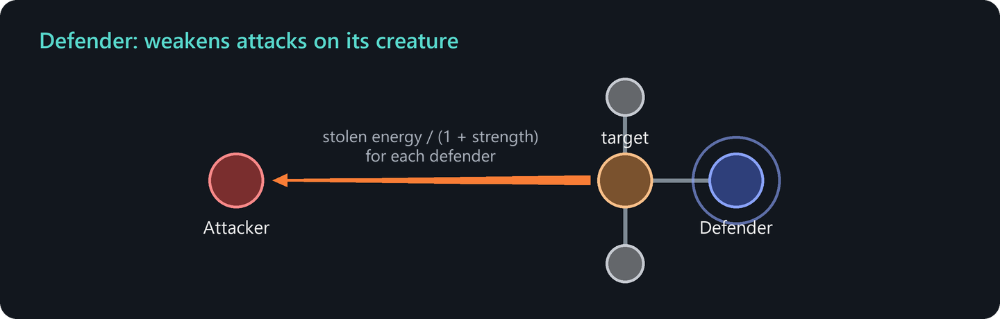

### Modes

| Mode | Effect |
| --- | --- |
| Anti-attacker | If an attacked cell is such a defender or is directly connected to such defenders, the stolen energy is divided by (1 + **Anti-attacker strength**) for each of these defenders. |
| Anti-injector | If the target of an injector is directly connected to such defenders, each of them raises the cost of the injection by the **Anti-injector strength** times the injector's **Energy cost**. With the defaults (cost 250, strength 0.5), one defender raises the cost to 375 and two defenders raise it to 500. |

**Parameters:** the *Cell type: Defender* group with **Anti-attacker strength** and **Anti-injector strength**, both 0.5 by default.

## Reconnector

A reconnector creates connections to other objects or removes them. Creatures can use it to hold on to rocks, to grab prey or to join other creatures.

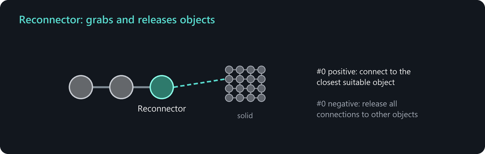

### Signals

| Channel | Meaning |
| --- | --- |
| #0 (input) | At least 0.1: connect the reconnector to the closest suitable object. Objects that are already connected to it, directly or through one other object, are skipped, so a signal that stays positive can add another connection in each cycle. At most -0.1: remove all connections of the reconnector to objects that do not belong to its own creature. |
| #2 (output) | 1 if a connection was created or removed, otherwise 0. |

### Modes

| Mode | Connects to |
| --- | --- |
| Solid | Solid objects. |
| Free cell | Free cells, optionally restricted to colors. |
| Creature | Cells of other creatures, optionally restricted by size, color and lineage. |

An object can have at most six connections, so a reconnector only connects if both sides have a free slot.

**Parameter:** the **Radius** in the *Cell type: Reconnector* group (2 by default).

## Detonator

A detonator explodes after a countdown and pushes everything around it away.

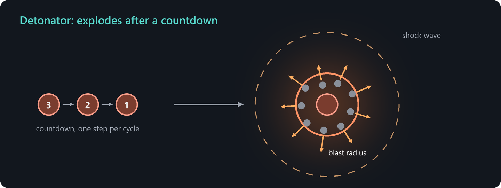

### Signals

| Channel | Meaning |
| --- | --- |
| #0 (input) | Starts the countdown if the absolute value is at least 0.1. |

### How detonation works

Once triggered, the detonator counts down one step per cycle. At zero it explodes: all objects within the **Blast radius** are pushed away, and objects closer to the detonator are pushed more strongly. Other detonators within the radius explode as well, each with the probability given by **Chain explosion probability**. A shock wave then travels outwards to eight times the blast radius. Static objects are not affected. An exploded detonator stays inactive.

### Properties

| Property | Meaning |
| --- | --- |
| Countdown | Number of cycles between trigger and explosion. One cycle comprises 6 time steps. |
| State | *Ready*, *Activated* or *Exploded* (inspection only). |

**Parameters:** the *Cell type: Detonator* group with **Blast radius** (10 by default) and **Chain explosion probability** (0.2 by default).

## Digestor

A digestor converts raw energy into usable energy. It is the stomach of a creature.

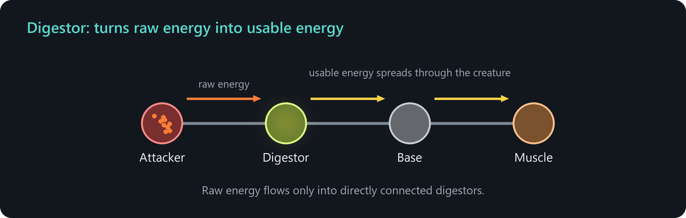

### How digestion works

Cells gain raw energy by absorbing energy particles and through attacks. Raw energy flows from any cell into directly connected digestors, and digestors pass it on to other connected digestors. In every cycle, each digestor converts part of its raw energy into usable energy, which then spreads through the creature by energy sharing between connected cells.

The two properties of a digestor are complementary: a high **Energy conductivity** means that the digestor passes on more raw energy to other digestors and converts less of it itself. A high **Energy conversion** means the opposite.

### Properties

| Property | Meaning |
| --- | --- |
| Energy conductivity | How much raw energy the cell takes in and passes on. Scaled by the **Max raw energy conductivity** parameter. |
| Energy conversion | How much raw energy the cell converts per time step. Scaled by the **Max raw energy conversion** parameter. |

**Parameters:** the *Cell type: Digestor* group with **Max raw energy conductivity** and **Max raw energy conversion**.

**Example:** Every attacker needs a digestor as a direct neighbor. Plant-like creatures that live on energy particles grow best when most of their cells are digestors.

## Memory

A memory cell keeps signals over time. It can delay, record, store and smooth signals and gives creatures a short-term memory.

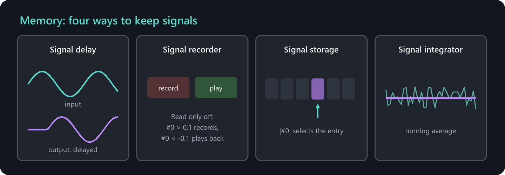

### Modes

| Mode | Function |
| --- | --- |
| Signal delay | Outputs the signal again after a fixed number of cycles. |
| Signal recorder | With **Read only** switched off, a channel #0 above 0.1 starts a recording: the signal of this cycle and of the following cycles is stored, one entry per cycle, until the buffer is full. A channel #0 below -0.1 plays the recording back, one entry per cycle. |
| Signal storage | The absolute value of channel #0 selects a buffer entry: 0 selects the first entry, 1 the last one. With **Read only** switched off, the sign selects the action: a value of 0 or more reads the entry and a negative value overwrites it with the current signal. |
| Signal integrator | Outputs a running average of the signal. |

### Properties

| Property | Meaning |
| --- | --- |
| Delay | For signal delay: the number of cycles, at most 32. |
| Read only | For recorder and storage: the cell only reads from the buffer and never overwrites it. It is switched on by default, so a recorder only records and a storage only writes after **Read only** has been switched off. A read-only recorder starts playing back its recorded entries when the absolute value of channel #0 is above 0.1. |
| New signal weight | For the integrator: the weight of the current signal in the average. At 0 the stored value is frozen, at 1 there is no smoothing. |
| Channel mask bit 0-3, Channel mask bit 4-7 | One checkbox per channel, for the channels #0 to #7. The checked channels are replaced by the stored values. All other channels pass through unchanged. |
| Signal buffer | Opens an editor for the stored entries. The buffer holds up to 32 entries. Predefined entries are useful for a read-only signal storage. A recorder plays back only as many entries as it has recorded itself, so a new read-only recorder plays back nothing, even if entries were set in the editor. The editor labels the channels #1 to #8, which correspond to the channels #0 to #7. |

**Example:** A read-only memory in *Signal storage* mode with a predefined sequence of strengths and directions for muscles lets a creature repeat a fixed pattern of movements. A generator in *Sawtooth signal* mode that feeds channel #0 of the memory moves through the entries in order if its minimum value is 0.

## Communicator

A communicator exchanges signals between different creatures. It allows swarms, warnings and cooperation.

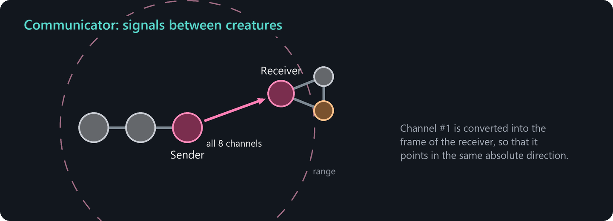

### Signals

| Channel | Meaning |
| --- | --- |
| #0 (input, sender) | Triggers a transmission if the absolute value is at least 0.1. |
| all (sender) | All eight channels of the sender are transmitted. |
| #1 | Interpreted as a direction. It is converted into the frame of reference of the receiver, so that it points in the same absolute direction. |
| all (output, receiver) | The receiver takes over the channels of the sender. Its neighbors read them in the next cycle. |

Communication only takes place between different creatures, and both sides need a valid front direction.

### Modes

| Mode | Properties |
| --- | --- |
| Send | **Range**: the radius in which receivers are addressed, at most 20. **One-way**: only receivers on the side opposite to the direction encoded in channel #1 are addressed. |
| Receive | **Restrict to colors** and **Restrict to lineage** select which senders are accepted. |

## Void

A void cell is a placeholder. It dissolves as soon as the cell network it belongs to is complete and passes its energy to its neighbors.

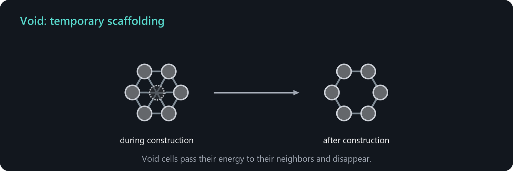

Void cells are useful for shapes that cannot be built directly. The shape generators build the cells in a fixed pattern, and void nodes reserve positions that are freed afterwards, for example to create gaps or holes. Void nodes cannot split a gene into separate pieces, because nodes that are connected to the last node only through void nodes are lost. The genome editor warns about this with *Nodes cut off from last node*, see [Rules for valid genomes](genomes.md#rules-for-valid-genomes). The first and the last node of a gene cannot be void, and void cells cannot carry a constructor.

## Constructor

A constructor builds new cells from a gene of the genome. It is not a cell type but an addition that any cell except void cells can carry. In the genome editor it is enabled by choosing a gene for **Construction**. Creatures grow and reproduce with constructors.

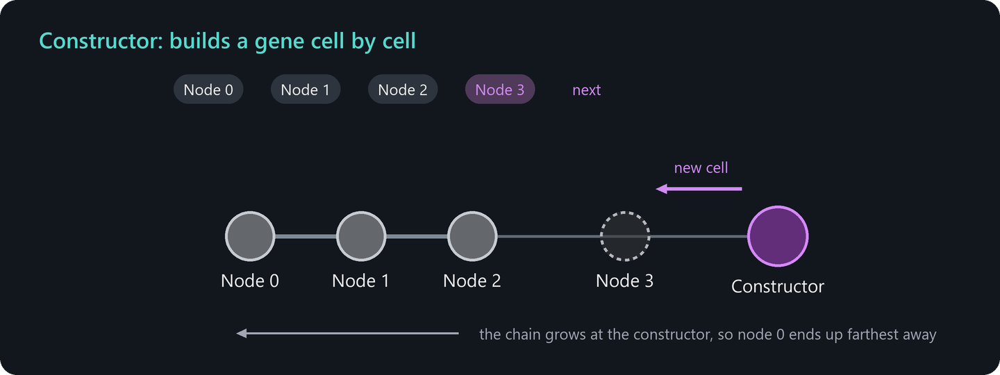

### Signals

| Channel | Meaning |
| --- | --- |
| #0 (input) | Triggers the construction of the next cell if no auto trigger interval is set and the absolute value is at least 0.1. |
| #4 (output) | 1 if a cell was built in this cycle. 0 if the constructor tried to build a cell but could not place it, for example because the new connection would cross existing connections. If the constructor is not triggered, has finished or lacks the energy for the next cell, it makes no attempt, and channel #4 keeps the value of the neural network. |

### How construction works

When triggered, the constructor builds the next cell of its gene. Each new cell costs the **normal energy** of a cell, 100 by default. The constructor pays from its energy reserve first and then from its own usable energy, but it never spends its usable energy below the normal energy. If this is not enough and the external energy pool is available, it requests energy from there, see [Energy](energy.md#the-external-energy-pool).

New cells are inserted between the constructor and the previously built cell. The first node of a gene therefore ends up farthest away from the constructor, and the last node next to it. The new cells stay inactive until the last node of the gene is built. With several concatenations or branches, each copy of the gene becomes active as soon as its own last node is built. If **Separation** is enabled, the finished cells detach and form a new creature.

### Properties

| Property | Meaning |
| --- | --- |
| Auto trigger interval | The constructor triggers itself every n time steps, with a phase that differs between creatures. Since cells act only every 6 time steps, values below 6 work like 6 and multiples of 6 work best. Without a value, channel #0 triggers it. |
| Construction angle | Direction of the first cell of the first branch, relative to the middle of the largest gap between the existing connections of the constructor cell. If the constructor cell has no connections, as with a seed, the direction is random. |
| Provide energy | *Cell only*: the constructor pays for each new cell. *Transitive cells*: it also provides an energy reserve for the constructors in the new cells, so they can build their own genes without further energy. *Free*: no energy cost. This mode cannot be set in a genome. Seeds created with energy use it. See [Energy for construction](genomes.md#energy-for-construction) for the limits of *Transitive cells* and *Free*. |
| Reserved energy | The energy reserve of the constructor (inspection only). The external energy pool and a parent constructor with *Transitive cells* fill it, and it is spent before the usable energy. |
| Separation | The finished construction detaches and becomes a new creature. Without separation, it stays attached and becomes part of the same creature, unless it is a construction of the root gene. Such a construction always becomes a new creature, which then stays attached to its parent. |
| Number of branches | How many copies of the gene are built next to each other around the constructor (without separation), up to 6 and at most as many as the constructor cell has free connection slots. |
| Concatenations | How often the gene is built in a row, each copy attached to the previous one. Can be infinite. |
| Gene index | The gene that is built. |

**Parameters:** the *Cell construction* group with **Connection distance** and the *Guided energy supply* group for the external energy. When a constructor places the first cell of a construction or of a further branch, it postpones the construction if the connection to this cell would cross existing connections of objects within the **Connection distance**. Later cells of a construction are not checked. The gene property of the same name is unrelated. The [Genomes and construction](genomes.md) chapter explains how constructors, genes and shapes work together.
