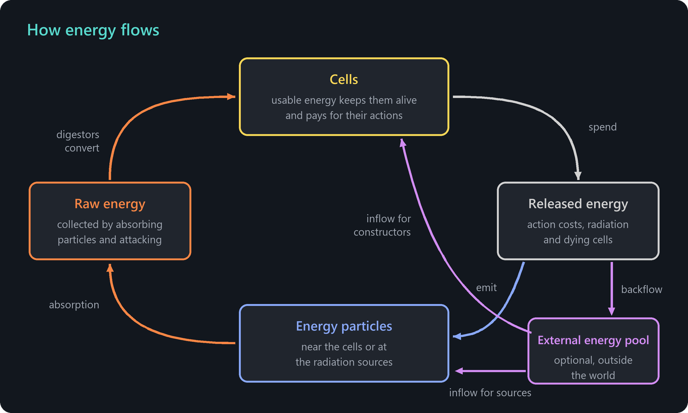

# Energy

Cells need energy to exist, to act and to build offspring. Understanding where energy comes from and where it goes helps to build stable ecosystems and to run evolution experiments.

## Forms of energy

| Form | Where it is |
| --- | --- |
| Usable energy | In every cell. It keeps the cell alive and pays for its actions. |
| Raw energy | In cells. Unprocessed energy from absorbed particles and attacks, which digestor cells convert into usable energy. |
| Energy reserve | In constructor cells. Energy set aside for construction, filled for example by the external energy pool. |
| Stored energy | In depot cells. |
| Object energy | In solids, fluids and free cells. It determines their brightness. The energy of a free cell is also food for creatures. |
| Energy particles | Free energy that drifts through the world. |
| External energy | In the external energy pool outside the world, if used. |

The energy inside the world is conserved. It changes its form, but the simulation never creates or destroys it, with two exceptions. The external energy pool can supply energy to the world and take energy back. Seeds created with **Create seed with energy** build their first creature without energy cost, which adds new energy to the world. The amount of energy also changes when you edit the world, for example when you create or delete objects. The [Evolution dashboard](user-interface.md#evolution-dashboard) shows the internal and the external energy.

## How cells gain energy

- **Absorbing energy particles.** When an energy particle hits a cell or a free cell, the object absorbs the fraction of the particle's energy given by the **Absorption factor**, which is 1 by default. A cell adds the absorbed energy to its raw energy, while a free cell adds it to its object energy. Static cells and static free cells do not absorb energy particles, with the exception of static digestors. Cells that are still under construction do not absorb them either. Fluids let energy particles pass, while connected solids reflect them.
- **Attacking.** Attacker cells steal energy from other cells and free cells. The stolen energy also becomes raw energy.
- **Digesting.** Digestor cells convert raw energy into usable energy. Raw energy flows from every cell into directly connected digestors.
- **Sharing.** Usable energy flows along connections between cells, from the cell with more energy to the cell with less. A cell that is not constructing passes its surplus above the normal energy on to a connected cell that is constructing. A constructing cell with at least the normal energy gives energy only to other constructing cells.
- **External inflow.** Constructors that lack energy can receive energy from the external energy pool.

## How cells lose energy

- **Construction.** Every new cell costs the normal energy, 100 by default.
- **Actions.** Attacks, injections and muscle movements can cost energy, as set in the parameter groups of the cell types.
- **Being attacked.** Attacker cells of other creatures steal energy from a cell. They take the stored energy of a depot first, then the energy reserve of a constructor and finally the usable energy.
- **Radiation.** Cells and free cells can emit energy continuously. *Radiation type I* lets them emit a fraction of their energy per time step once they are older than a minimum age. *Radiation type II* lets them emit a fraction of their energy per time step as long as this energy is above a threshold. Usable and raw energy are compared with the threshold separately. Both are off by default.
- **Death.** Dying cells disintegrate and release all their energy.

## Where released energy goes

Whenever energy is released, for example through action costs, radiation or the death of a cell, it goes through two steps:

1. If the **Backflow** of the cell's customization color is greater than zero, that fraction of the energy flows back into the external energy pool, as long as the pool holds less than the **Backflow limit**.
2. The rest becomes an energy particle. The **Relative strength** of the base parameters gives the share of particles that are created right next to the cell. The other particles are created at one of the **radiation sources**, chosen according to their relative strengths.

## Energy particles

- Energy particles fly in a straight line until they are absorbed or bounce off connected solids. Inside a layer with a [force field](simulation-parameters.md#force-field), the field also bends their path.
- Particles that come close to each other merge into one larger particle.
- A particle with more energy than the **Minimum split energy** splits into two after a while.
- If **Energy to cell free transformation** is enabled, a particle turns into a free cell as soon as its energy reaches the normal energy.
- Free cells disintegrate into energy particles again when their age exceeds the **Maximum free cell age**. If their energy is below the minimum energy, they disintegrate with the probability per time step given by the **Decay rate of dying cells**, 0.001 by default.

## Radiation sources

A radiation source is a place where energy particles appear. Sources are added with **Add radiation source** in the **Simulation parameters** window. Each source has a position, an optional velocity, a circular or rectangular shape and an optional **Radiation angle** that makes all its particles fly in one direction.

A source receives energy in two ways:

- A share of all energy released in the world, given by its **Relative strength**. The relative strengths of all sources and of the base add up to 1.
- Energy from the external energy pool. In each time step, a source receives the **Inflow for sources** of each color multiplied by its **Relative strength**.

Radiation sources create fertile places where plant-like creatures can live on the particles. Combined with the radiation of cells, they keep energy circulating.

With hardware ray tracing, a source also shines from its area. Its **Light color**, **Light brightness** and **Light range** set the color of the light, its brightness and how far it reaches. The objects around it cast shadows, which appear as columns of light and shadow. Its **Shadow strength** sets how much of the light the objects block. See [Generative art](generative-art.md#ray-tracing).

## The external energy pool

The *Guided energy supply* parameter group controls an energy pool outside the world:

| Parameter | Meaning |
| --- | --- |
| External energy amount | The energy in the pool. It can be infinite. |
| Inflow for constructors | The maximum energy a constructor cell receives from the pool per construction attempt when it lacks energy. If the pool cannot satisfy all requests, the energy is distributed proportionally. |
| Inflow threshold factor | The fraction of the required energy that a constructor must have by itself before it may request energy from the pool. |
| Inflow only for first offspring | Only constructors that have not produced an offspring yet receive energy, and in each creature only the first of them that requests it. Constructors that build parts of their own creature are not restricted. |
| Inflow for sources | The energy per time step and color from which the inflow of the radiation sources is calculated. Each source receives this amount multiplied by its **Relative strength**, so the sources together receive less than this amount as long as the relative strength of the base is above 0. |
| Backflow | The fraction of released energy that flows back into the pool. |
| Backflow limit | Backflow stops while the pool holds more than this amount. |

As long as the **External energy amount** is finite, energy only moves between the world and the pool, so the total of internal and external energy stays constant. With a backflow, released energy also returns to the pool, and you can control the amount of life in the world through the size of the pool.

## Typical setups

**Closed cycle for evolution.** Fill the external energy pool, give constructors an inflow, set a backflow of 0.5 to 1 and a finite maximum age for cells. Old cells die, their energy returns to the pool, and new offspring can be built from it. The population settles at a level that depends on the size of the pool.

**Radiation-driven ecosystem.** Place radiation sources and let them draw from the external energy pool with **Inflow for sources**. Plant-like creatures with many digestor cells absorb the particles, herbivores attack the plants and predators attack the herbivores.

**Free energy for art.** Seeds created with **Create seed with energy** build their first creature without energy cost. For decorative scenes, no energy supply is needed at all, as long as the creatures do not reproduce.

## Troubleshooting energy

- **The population explodes and the simulation slows down.** There is too much energy. Reduce the **External energy amount** or the inflow, or add radiation and a maximum age.
- **Creatures do not build anything.** Their constructors lack energy. Check the **External energy amount**, **Inflow for constructors** and **Inflow threshold factor**, or give the creatures a way to collect energy.
- **Everything dies after a while.** Energy leaks out of the creatures faster than they can collect it. Check action costs and radiation, and make sure that released energy can be used again, for example through backflow or radiation sources.
- **Attackers gain nothing.** Every attacker needs a directly connected digestor cell, and it only attacks when a signal in channel #0 triggers it. In *Creature* mode, it only attacks creatures that a sensor of its own creature has detected in the same cycle. This sensor must work in *Detect creature* mode with **Tag for attackers** enabled. See [Attacker](cell-types.md#attacker).
