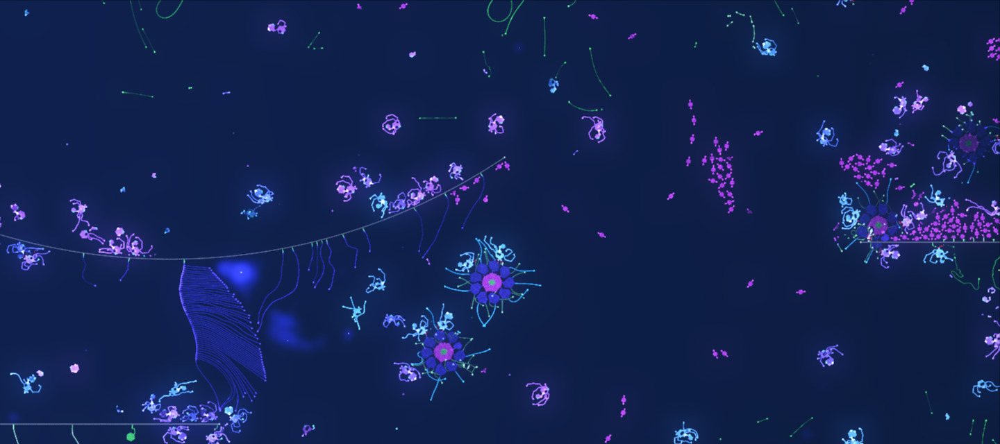

# Evolution experiments

Evolution needs three ingredients: creatures that **replicate**, offspring that **vary** because of mutations, and **selection**, which arises because resources are limited and not every creature can survive. ALIEN provides all three. As the experimenter, you set up the conditions and observe what happens. This chapter shows how.

## Start with a preset

The quickest way to see evolution in action is a prepared experiment:

1. In the **Browser** (Alt+B), choose the **Simulations** tab and the **Featured** workspace.
2. Open a simulation from the **Evolution/Presets** folder, for example *Hanging Garden/Base*.
3. Open the **Evolution dashboard** (Alt+3) and run the simulation.

Evolution takes time. Interesting changes often appear only after hundreds of thousands or millions of time steps. Let the simulation run for a long time, if necessary in [console mode](user-interface.md#console-mode) (Alt+C), which leaves all computing power to the simulation. The **Evolution/Results** folder contains snapshots of the same experiments after long runs, so you can see what may emerge.

## Watching evolution

The **Evolution dashboard** (Alt+3) shows how the population develops:

- The **cards** at the top show how many creatures, cells and lineages exist and how much energy is in the world and in the external energy pool.
- The **plots** show the development over time: number of creatures, average number of cells per creature, average number of genome nodes, average generation, average mutation rate and the energy stored in the creatures. A rising number of genome nodes indicates that genomes become more complex. Four more plots show rates per 1,000 time steps. Two of them show the number of created creatures and how much the genomes change through mutations. The other two show the energy gained by attacks and the muscle activity, both per creature.
- The **lineage table** lists the groups of related creatures. A new lineage is founded whenever the mutations that a creature has accumulated within its current lineage exceed the **New lineage threshold** parameter. Click the button with the DNA icon in the **Creatures** column of a lineage to open the genome of one of its creatures in the genome editor. That creature has the highest generation in the lineage.

The **Object coloring** parameter in the *Visualization* group can color creatures by lineage. This shows directly how lineages spread and displace each other.

## Ingredient 1: Replicators

A replicator is a creature whose genome contains a constructor that builds the root gene (gene 0) with **Separation** switched on. The [tutorial](first-creature.md#step-7-let-it-reproduce) shows how to create one. Important settings of the constructor:

- **Auto trigger interval** sets how often the constructor tries to build the next cell. Smaller values mean faster reproduction.
- **Provide energy** decides whether the constructor pays only for each new cell (*Cell only*) or also gives the constructors inside the offspring an energy reserve for building their genes (*Transitive cells*). Inside the offspring, a constructor that builds the root gene receives no reserve, so the offspring has to obtain the energy for its own reproduction elsewhere. See [Genomes and construction](genomes.md#energy-for-construction).
- **Separation** must be on for the constructor that builds the offspring. Constructors that build parts of the creature's own body keep it off.

## Ingredient 2: Variation

Mutations occur when a creature starts to build its first offspring. Its genome is copied and mutated once. From then on, the creature uses the mutated genome and passes it on to all of its offspring. Each offspring mutates the genome again when it starts to reproduce itself. A seed created in the genome editor passes on its genome unchanged.

**The mutation rates are stored in every genome**, so different creatures can mutate differently. In a new genome, the main probability of every mutation (**Node probability**, **Gene probability** or **Genome probability**) is zero, so nothing mutates until you set rates or switch on [meta-mutations](#letting-evolution-choose-the-rates).

Open the genome in the genome editor. In the left column, the **Genome** group contains the **Mutation rates** row with the **Edit (N active)** button. N is the number of kinds of mutation whose main probability is above zero, and the tooltip of the row lists them with their probabilities. The button opens a dialog with all rates. There are two groups of mutations:

**Changes to properties.** For each of these you set a main probability per node or per gene and the strength of the change. Some also have probabilities for changes between fixed options: **ActFn change probability** for activation functions, **Constructor toggle probability** for adding or removing a constructor and **Enum change probability** for switches, selections and the shape generator. These probabilities only apply to the nodes or genes that the main probability selects. Each of these mutations comes in two variants, **Mutation rate 1** and **Mutation rate 2**, so you can combine frequent small changes with rare large ones.

| Mutation | What changes |
| --- | --- |
| Connection weight mutations | The weights with which a cell reads the signals of its neighbors |
| Neuron mutations | Weights, biases and activation functions of the neural networks |
| Cell type property mutations | The settings of the cell types, for example the range of a sensor |
| Geometry mutations | The stiffness and the shape generator of genes |
| Constructor mutations | The settings of constructors. A constructor can also be added or removed |

**Changes to the structure.** For these you set only a probability.

| Mutation | What changes |
| --- | --- |
| Cell type mutations | A node gets a different cell type |
| Cell type mode mutations | A cell type switches to a different mode, for example a sensor to another detection mode |
| Customization mutations | A customization color used in the genome is replaced everywhere by another one |
| Void mutations | A node is toggled between void and a real cell type |
| Extend gene and Add node mutations | New nodes are added to genes |
| Trim gene and Delete node mutations | Nodes are removed |
| Copy and Move node section mutations | Groups of nodes are copied or moved to another place in the same gene or in another gene |
| Add, Duplicate, Delete and Swap gene mutations | Genes are created, copied, removed or exchanged |

Every mutation is explained in detail in its tooltip. Probabilities between 0.001 and 0.01 are a reasonable starting point. Rates that are too high destroy working genomes faster than selection can keep up.

### Letting evolution choose the rates

Instead of setting the rates by hand, you can let them evolve. If the **Apply meta-mutations** genome option is switched on, which is the default, the main probability of every mutation also changes slightly each time the genome mutates. The strengths and the other probabilities, such as the **Enum change probability**, stay as they are. How much the main probabilities change is set in the *Meta-mutations* groups of the simulation parameters, for example with **Neuron sigma**. These sigma parameters are 0 by default, so the main probabilities stay fixed.

The evolution presets use this approach. All their sigma parameters are set to 0.0002, except **Customization sigma**, which is 0, so the probability of customization mutations stays at zero. The genomes in the *Matrix* preset start with all main probabilities at zero, while those in the *Vortices* preset start with small probabilities between 0.0005 and 0.005 for all kinds except customization mutations. Over millions of time steps, successful lineages end up with different probabilities for each kind of mutation, mostly between about 0.0001 and 0.015 and higher for a few kinds.

## Ingredient 3: Selection

Selection arises automatically when resources are limited. In ALIEN, the central resource is **energy**. Every new cell costs energy, so a population can only grow as long as energy is available. Creatures that gather energy more efficiently produce more offspring.

There are two basic ways to supply energy:

- **External energy pool.** The *Guided energy supply* parameter group controls an energy pool outside the world. Constructors draw energy from it when they build new cells (**Inflow for constructors**), and radiation sources can draw from it to emit energy particles (**Inflow for sources**). When cells release energy, a part of it flows back into the pool (**Backflow**). This creates a cycle. As long as the **External energy amount** is finite, the total of internal and external energy stays constant.
- **Energy in the world.** Energy particles (for example from radiation sources), free cells and the cells of other creatures are food. Creatures with sensors, attackers and digestors can collect it. This leads to plants, herbivores and predators.

To keep evolution going, old creatures must make room for new ones. Setting a **Maximum age** for cells (*Cell life cycle* group) ensures that creatures eventually die and return their energy.

## A recipe for your own experiment

1. Create a new world (Ctrl+N), for example 1000 x 600, with an **Energy** of 1,000,000 for the external energy pool.
2. Design a replicator in the genome editor or open a genome from the **Browser**.
3. Set mutation rates in the genome, for example a probability of 0.005 for neuron, connection weight and cell type property mutations and 0.001 for add node and delete node mutations. Alternatively, set all sigma parameters in the *Meta-mutations* groups to 0.0002 and let the rates evolve.
4. In the simulation parameters, set **Maximum age** to about 50,000 time steps and **Backflow** to 0.8, so that the energy of dead cells mostly returns to the pool.
5. Place a few seeds with **Create seed with energy** and run the simulation.
6. Watch the **Evolution dashboard**. If the population explodes, reduce the external energy or the inflow. If it dies out, increase them or give the creatures more time to reproduce.

The preset *Hanging Garden* follows this pattern. It uses an external energy pool with 12 million energy units, a backflow of 0.8, maximum ages between 120,000 and 500,000 time steps and meta-mutations of 0.0002. It also adds layers with gravity and storms, which vary the conditions across the world.

## Shaping the environment

The environment determines which creatures succeed. Some possibilities:

- **Layers** change parameters in parts of the world, for example a zone with higher friction, a death zone with a high **Minimum energy** or strong radiation, or a current that carries creatures along. See [Simulation parameters](simulation-parameters.md#layers-and-radiation-sources).
- **Radiation sources** emit energy particles at places you choose, which creates fertile spots.
- The **Food chain color matrix** (*Cell type: Attacker* group) decides which colors can eat which. Together with customization mutations it allows complex food webs.
- **Solid structures** such as walls, rocks and labyrinths divide the world into habitats.

## Tips

- Save your experiment regularly, or click **Autosaves** in the left column of the browser and tick **Enable autosave** in the right column. ALIEN then saves the simulation at the interval set there and keeps a series of autosaves.
- Use **flashbacks** in the **Temporal control** window to try out changes and to return to an earlier state of the world. Loading a flashback restores the world, the **External energy amount** and the positions of moving layers and radiation sources, but keeps all other simulation parameters. If you changed other parameters, set them back yourself.
- Running experiments for days is easier with the [command line interface](files.md#command-line-interface), which runs a simulation file without any window.
- Ask an [AI agent](ai-agents.md) to monitor the experiment, analyze the lineages and suggest parameter changes.
