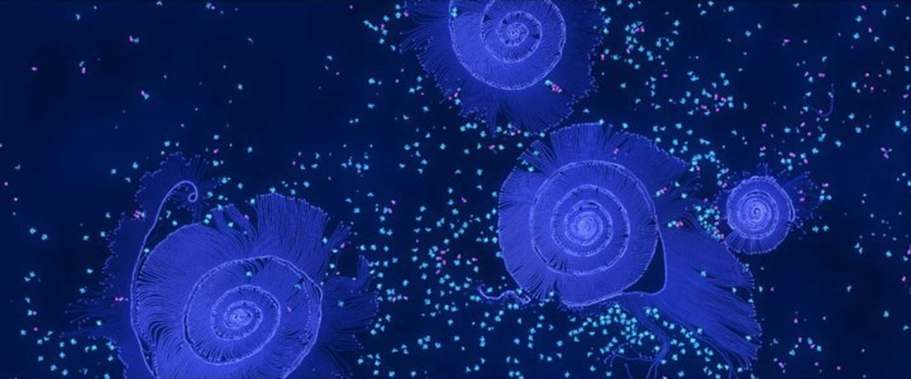

# Generative art

ALIEN renders every particle with light and color, and evolution and physics constantly produce new forms. This makes it possible to create pictures and animated scenes. This chapter collects the relevant settings and techniques.

## Get inspired

The **Browser** (Alt+B) contains an **Artwork** folder in the **Featured** workspace. Open the simulations there, look at how they are built and change them. To learn how the shapes were grown, switch to edit mode with **Alt+E**, select cells of a creature and press **Alt+P** to inspect the creature or **Alt+F** to open its genome in the genome editor.

## Colors and light

The look of a world is controlled by the *Visualization* parameter group in the **Simulation parameters** window (Alt+4):

- **Background color** sets the color of empty space.
- **Customization colors** defines the palette of ten colors that all objects use. Changing a palette entry recolors every object of that color at once.
- **Object coloring** decides how objects are colored:
  - *Energy* draws all objects in gray, brighter with more energy. Energy particles keep their blue color.
  - *Customization* uses the palette color of each object.
  - *Lineage + Customization* keeps the palette color but shifts the hue slightly per lineage.
  - *Lineage* and *Creature* give every lineage or every creature its own color.
- **Glow** controls the bloom effect that makes bright objects shine.
- **Hardware ray tracing** renders the world with [ray tracing](#ray-tracing) on GPUs that support it.
- With hardware ray tracing, **Fluid illumination** sets how strongly the cells and the radiation sources light the fluids.
- **Light color**, **Light brightness**, **Light range** and **Shadow strength** set how a radiation source shines with hardware ray tracing.
- **Borderless rendering** repeats the world periodically, which is useful for seamless patterns.
- **Grid lines** and **Mark reference domain** draw helper lines, which you usually switch off for pictures.

The **brightness** of an object follows its energy. Objects with little energy look dim, energetic objects bright. Use this deliberately. To shade a rock, give it zones with different energies. To make creatures stand out, keep them at a higher energy. Connected solids appear as smooth surfaces with smooth outlines, so a rock shows its shading instead of its particles. The particles only become visible when you zoom in closely.

> **Tip:** Dense fluids with high energy and a high **Glow** of their particles wash out to white. This **Glow** is not the **Glow** parameter of the bloom effect. For colorful fluids, set these values in the option card of the creation tool: a low **Energy** per particle, for example 10 to 15, and a **Glow** of at most 0.4. Where the tool offers it, also set an **Object distance** of 1.2 or more.

## Ray tracing

On a GPU with ray tracing hardware, ALIEN shows the creatures as living tissue under a microscope when you zoom in. This requires the **Hardware ray tracing** parameter, which is on by default and is saved with each simulation. If it is switched off, ALIEN shows the normal view without the effects described here and needs less GPU time. Other GPUs always show the normal view. Triangles and quadrangles of connected cells form translucent bodies with soft, slightly irregular outlines. The cells bulge gently out of these bodies. Connections without a polygon become thin strands, so chains of cells look like filaments. Only connected cells merge into one body. Cells without a connection stay apart, even when they touch.

Every cell shows wavy walls towards its neighbors. Zoomed in further, a few small dark organelles appear, and each cell shows a neuron: a small body in its middle with a branched dendrite towards every cell it is connected to. The dendrites reach the walls, where they interweave with those of the neighbors. The body and the dendrites become brighter in the color of the cell while signal #0 is positive or while the cell is attacked, and the body then shines with a soft halo. The glow follows the signal with a short delay, so it does not flicker when the signal changes rapidly. These details stay with their cell while it moves. Zoomed out, every cell keeps its own color, so the cells of a body stay distinguishable. On a dark background the tissue is visible by its glow as in a fluorescence microscope. On a bright background it absorbs light as in a brightfield microscope and appears slightly embossed. When zoomed out, the tissue fades into the normal view, so that small structures keep their details and the brightness stays the same.

Fluids appear as a glowing nebula, while energy particles keep their normal look. Thin gas glows in saturated colors, dense gas shines towards warm white, and the edges of the clouds glow brighter. The cells light the nebula around them in their colors, as strongly as the **Fluid illumination** parameter allows. Their light fades with distance, and dense gas and creatures cast shadows. The glow of active neurons stays in the cells, so the nebula does not flicker. Glowing fluid particles shine as sparks.

The radiation sources shine from their areas. Their light illuminates the objects around them and lights the fluids as strongly as **Fluid illumination** allows. It also appears as columns of light in a faint haze. The objects in its path cast shadows. Cells and free cells tint the light that passes through them in their own colors, while solids and dense fluids only darken it. The shadows become softer the farther they fall. Within the area of a source, the light comes from all sides and casts no shadows. The **Light color**, **Light brightness** and **Light range** parameters of each radiation source set in which color, how bright and how far it shines. Its **Shadow strength** sets how much of the light the objects and fluids in its path block. At 0, the light penetrates them completely and they cast no shadows.

Every frame is computed in full and without random samples, so the image has no noise in motion and does not change while the simulation is paused. Pictures saved with **Simulation > Save picture** average several frames for smoother edges.

## Painted backgrounds

**Layers** can paint the background. A layer covers a circular or rectangular area, and its **Background color** tints this area when the color override of the layer is enabled. Layers fade out at their edges, so several overlapping layers blend into soft color fields.

A layer with a **force field** additionally darkens the background according to the height map of the field if **Show force field** is enabled. The force field of a new layer is off until you tick the checkbox in front of **Field type** and choose a type. A *Perlin noise* field changes over time while the simulation runs, so the background turns into clouds that slowly change their shape, even if the strength of the field is set to 0. This is an easy way to create an animated, cloudy background for a scene.

See [Simulation parameters](simulation-parameters.md#layers-and-radiation-sources) for all layer settings.

## Growing shapes from genomes

Genomes determine the shapes that creatures grow. A few techniques:

- **Shapes.** Every gene has a shape generator: *Segment*, *Triangle*, *Rectangle*, *Hexagon*, *Tube*, *Large Lolli*, *Small Lolli* and *Zigzag*. Hexagons and lolli shapes make petals, discs and heads. Segments make stems and tentacles.
- **Branching.** A constructor with a higher **Number of branches** builds the same gene several times around its cell, up to six times. This creates stars and pinwheels. Each branch stays connected to the constructor cell, and a cell can have at most six connections, so the cell builds at most as many branches as it has free connection slots. **Number of branches** is only available without **Separation**.
- **Concatenations.** A constructor can build a gene several times in a row. Combined with a small angle at the first and last node, this produces curved stems and spirals.
- **Recursion.** A constructor that builds its own gene creates endless branching structures such as dendrites, lichen or fractal trees. Two such constructors at opposite angles give a tree. Give a node of the recursive gene a constructor that builds a flower gene. Every copy of the gene then grows a blossom, so the blossoms appear on every level of the tree and not only at its outer ends. If the recursive gene is not the root gene, the genome editor shows a *Cycle avoiding the root gene* warning. In this case, the recursion is turned off in the genome as soon as the creature starts to build offspring, which stops the growth.
- **Free energy.** **Create seed with energy** builds the first creature without energy cost, so even large structures appear without any energy supply. Parts that the creature builds itself from genes other than the root gene are free as well if **Separation** is off, because they belong to the same creature. A recursive gene of this kind therefore keeps growing without any energy until it runs out of room or the creature starts to build offspring. Copies of the root gene are new creatures and need energy, for example from the external energy pool, so the available energy limits how many of them are built.
- **Infinite age.** Keep the **Maximum age** at infinity for art, so that grown structures do not fall apart.

The [Genomes and construction](genomes.md) chapter explains every constructor setting.

## Color changes over time

The **Object color transition rules** expert setting in the [simulation parameters](simulation-parameters.md#object-color-transition-rules) lets the colors of cells and free cells change over time. For each color you define a target color and a duration. Cycles of colors make creatures shimmer or let the colors of a scene change gradually. On creatures, the changes are only visible if **Object coloring** is *Customization* or *Lineage + Customization*. Solids, fluids and static objects keep their colors.

## Taking pictures

- **Simulation > Save picture** renders the current view as an image file. You can choose a width and height larger than the screen for high-resolution prints.
- **Tools > Recorder** (Alt+V) flies the camera along waypoints and records the simulation without the user interface as an MP4 video.
- **View > Render UI** (Alt+U) hides all windows, which gives a clean view for screen recordings.
- **F7** switches between full screen and window mode.
- An [AI agent](ai-agents.md) can take screenshots through the MCP server and search for good camera positions.

## Ideas

- Fill a world with a sparse fluid in several colors and let a radial force field stir it into a galaxy.
- Grow a garden of fractal trees on rocks under a slowly changing nebula.
- Convert a drawing with the **Image converter** (Alt+Y) and place a static floor below it. Add a layer with a downward *Linear* force field as gravity and let the drawing crumble on the floor by lowering the **Maximum force**.
- Let an evolution experiment run for a day and color the creatures by lineage. The result shows how the lineages spread.
