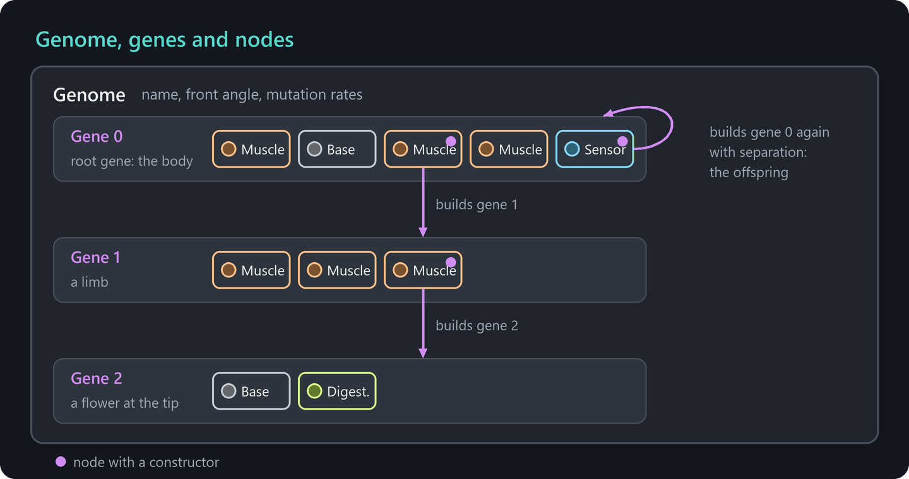
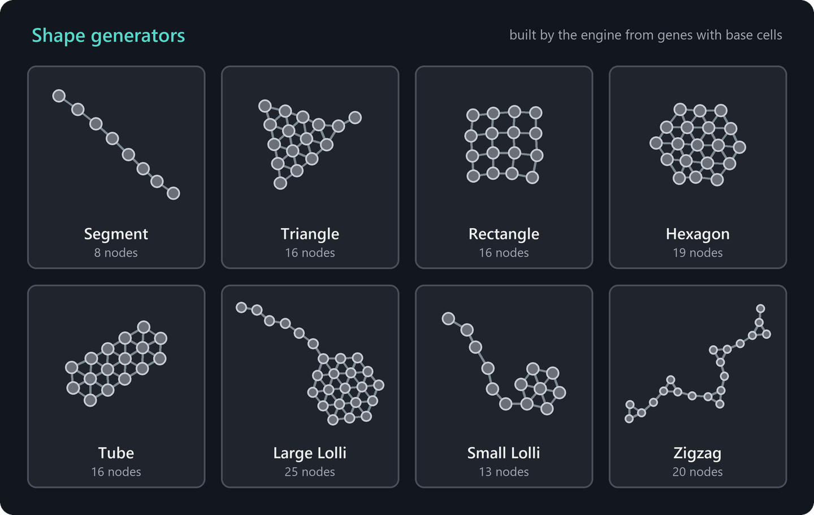
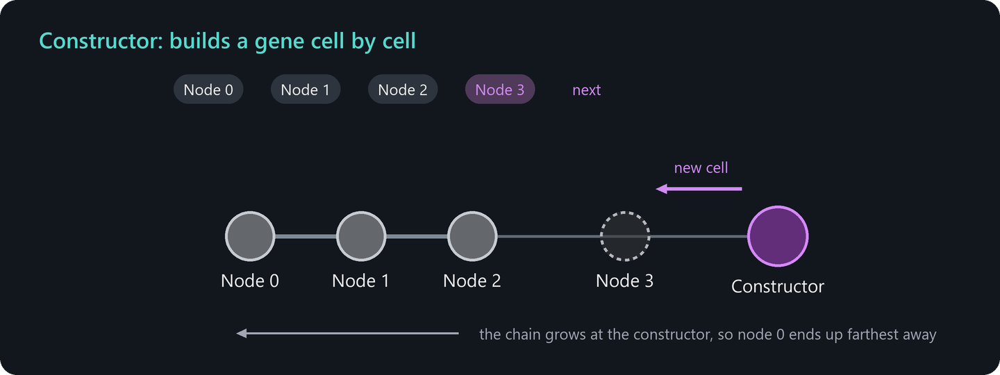

# Genomes and construction

The genome is the blueprint of a creature. This chapter explains its structure, all of its settings and how constructors turn it into cells. It also describes the genome editor in detail. For a hands-on introduction, start with [Your first creature](first-creature.md).

## Structure of a genome

A genome has three levels:

| Level | Contains |
| --- | --- |
| **Genome** | A name, the front angle, the mutation rates and a list of genes. |
| **Gene** | A shape generator, the connection distance, the stiffness and a list of nodes. |
| **Node** | Everything about one cell: angle, color, cell type with its properties, neural network and optionally a constructor. |

The first gene, gene 0, is the **root gene**. It describes the body of the creature. Further genes are built by constructors, which turn them into limbs, organs or ornaments of the same creature, or into new creatures if the constructor uses **Separation**.

## The genome editor

Open the genome editor with **Editor > Genome editor** (Alt+W). Each open genome has its own tab. The **+** at the end of the tab bar creates a new genome. The editor shows three columns:

- **Left column.** The genome properties and the **Structure** list. The list shows every gene with its nodes. For each gene it shows the colors used, the number of nodes, the shape, the genes it references and the genes that reference it. For each node it shows the color, the cell type and the gene it constructs. Genes and nodes that break a [rule for valid genomes](#rules-for-valid-genomes) are highlighted, for example genes that cannot be reached from the root gene and are therefore never built. Their tooltip explains the problem and its correction. The buttons below the list add genes and nodes, remove the selection, move it up or down and fix all warnings at once by applying these corrections.
- **Middle column.** The properties of the selected gene or node, including the neural network of a node.
- **Right column.** The **Phenotype** and **Gene network** tabs. **Phenotype** shows a live **preview** of the creature, simulated in a small separate world. If the genome forms more than one kind of creature, for example because a gene other than the root gene is built with **Separation**, each kind gets its own preview. Below the previews, one button switches on a detailed simulation that includes signals and muscles, and another shows the neural activity editor. Further buttons run, pause, step or restart the preview. While the detailed simulation is on, select a cell in the preview to set its signal and memory values in the neural activity editor and watch how the creature reacts. **Gene network** shows the genes and their constructor references as a graph and highlights the genes and constructors with warnings.

Below the three columns, a status bar shows the number of genes, nodes and warnings. Clicking the warnings opens the **Gene network** tab.

The tool bar at the top offers:

| Button | Function |
| --- | --- |
| Open genome, Save genome | Load and save genome files (*.genome*). |
| Share genome | Upload the genome to the server so that it appears in the browser. |
| Clone genome | Open a copy of the current genome in a new tab. |
| Copy genome, Paste genome | Copy the genome to an internal clipboard of the genome editor and replace the genome of the current tab with the copied one. |
| Close other tabs | Close all tabs except the current one. |
| Create save point, Revert to save point | Remember the current state of the genome and return to it later. Saving, pasting and injecting the genome also set a new save point. |
| Change colors | Replace one color with another in all nodes. |
| Inject genome | Replace the genome of the selected creatures in the simulation with the current genome. |
| Create seed | Place a seed with this genome in the middle of the view. It needs energy to build its creature. |
| Create seed with energy | Place a seed that builds its first creature without energy cost. |

> **Tip:** To edit the genome of an existing creature, select one of its cells in edit mode and press **Alt+F**. The genome opens in a new tab. After editing, select the creatures and use **Inject genome**, or create new seeds.

## Genome properties

| Property | Meaning |
| --- | --- |
| Genome name | Name of the genome. Every creature built from it inherits the name. |
| Front angle | Defines the front direction of the creature as an angle measured from the first connection of the head cell. New genomes in the editor start with -180 degrees, which makes the front point away from the rest of the body. Changing the shape generator of the root gene sets the front angle to a value that suits the shape: -180 for *Segment*, -150 for *Triangle*, -90 for *Rectangle* and -120 for the other shapes. |
| Resistance to injection | Injector cells of other creatures cannot take over cells of this creature. |
| Apply meta-mutations | The mutation rates of this genome are themselves mutated. See [Evolution experiments](evolution.md#letting-evolution-choose-the-rates). |
| Mutation rates | The probabilities and strengths of all mutations. The **Edit (N active)** button opens the full list. N is the number of kinds of mutation that are active, and the tooltip of the row lists them with their probabilities. |

## Gene properties

| Property | Meaning |
| --- | --- |
| Gene name | A name for your own reference, shown together with the gene number, for example in the structure list and in the gene network. It has no effect on the simulation. |
| Shape generator | Determines how the nodes are arranged, including their angles and additional connections. See below. |
| Connection distance | The distance between two cells that are built one after another. Values range from 0.5 to 1.5. Larger values make the creature bigger. |
| Stiffness | How strongly the cells resist the deformation of their connections. Mutations keep it between 0.05 and 1, but the editor only enforces the minimum of 0.05. Low values make soft, wobbly bodies. |
| Homogeneous cell type | Every cell of this gene uses the cell type and the cell type properties of the first node. Colors, angles, neural networks and constructors remain set separately for each node. |

### Shapes

The shape generator arranges the nodes of a gene into a geometric pattern. It also adds connections between cells that are next to each other in the pattern, which makes the shape stable.

| Shape | Description |
| --- | --- |
| Segment | A line of cells. Only the first and the last node can be bent with their angle. |
| Triangle | A filled triangle that grows edge by edge. |
| Rectangle | A filled square that grows layer by layer, with node 0 in a corner. 4, 9, 16 or 25 nodes give complete squares. |
| Hexagon | A filled hexagon that grows layer by layer. 7, 19 or 37 nodes give complete hexagons. The node in the center changes with each layer: node 4 for 7 nodes, node 3 for 19 nodes and node 12 for 37 nodes. |
| Tube | A band of cells, three cells wide. |
| Large Lolli | A hexagonal head of 19 cells, followed by a thin tail for all further nodes. |
| Small Lolli | A small head, followed by a thin tail. |
| Zigzag | A thin line that changes its direction back and forth every four nodes, with a small triangle of cells at each bend. |

The picture above shows the shapes with 8, 16, 16, 19, 16, 25, 13 and 20 nodes.

## Node properties

| Property | Meaning |
| --- | --- |
| Angle | The angle of this cell relative to the connection to the previous cell. It is only evaluated for the first and the last node of a gene. The angle of the last node bends the gene where it is attached to the constructor, or to the next copy if the gene is concatenated. The angle of the first node only takes effect in the second and later copies of a concatenated gene, where it bends the joint to the previous copy. For the inner nodes the angle results from the shape. |
| Customization | The customization color of the cell. Many simulation parameters are defined per color. |
| Type | The cell type and its properties, see [Cell types](cell-types.md). |
| Construction | The gene that this cell builds as a constructor, or *None*. Choosing a gene shows the construction properties. |
| Neural network | The weights, biases and activation functions of the neural network of the cell, and the connection weights that set how strongly the cell listens to each of its connections. See [Neural networks and signals](neural-networks.md). |

## How construction works

A constructor builds the cells of its gene one after another, one cell per trigger:

1. The first cell of a new branch is placed next to the constructor, in the middle of the largest gap between the existing connections of the constructor cell. In the first branch, the **Construction angle** turns this direction. If the constructor cell has no connections, as with a seed, the direction is random.
2. Each following cell is inserted between the constructor and the previously built cell. The chain therefore grows at the constructor, and the **first node ends up farthest away** while the last node ends up next to the constructor.
3. The shape generator adds connections between the new cell and its neighbors in the pattern.
4. While the construction is running, all its cells are in the *Under construction* state and inactive.
5. When the last node is built, the cells are activated. With several concatenations or branches, each copy of the gene becomes active as soon as its own last node is built. With **Separation**, the last cell is not connected to the constructor, so the finished construction detaches and becomes a new creature.

Because each cell copies the signal of its first connection by default, and the first connection of node *i* points to node *i+1*, signals flow from the last node towards node 0. Place sensors at the end of a gene and acting cells closer to node 0.

### Constructor properties

| Property | Meaning |
| --- | --- |
| Auto trigger interval | The constructor tries to build the next cell every n time steps. The phase differs per creature, so creatures do not build in sync. Without a value, the constructor is triggered via channel #0. |
| Construction angle | The direction of the first cell, see above. It is only used for the first cell of the first concatenation in the first branch. |
| Provide energy | See [Energy for construction](#energy-for-construction). |
| Separation | The finished construction detaches and becomes a new creature. A constructor that builds the root gene always creates a new creature. Without separation, this offspring stays attached to its parent. |
| Number of branches | How many copies of the gene the constructor builds around itself, up to 6 and at most as many as the constructor cell has free connection slots. Only without separation. |
| Concatenations | How often the gene is built in a row, each copy attached to the end of the previous one. Choose infinity for structures that grow without end. |

The output channel #4 of a constructor cell reports 1 when a cell was built and 0 when an attempt failed, for example because the new connection would cross existing connections. If the constructor was not triggered, has finished or lacks the energy for the next cell, it makes no attempt, and channel #4 keeps the value that the neural network of the cell calculated.

### Energy for construction

Every new cell costs the **normal energy** of the constructor's color, 100 by default. The constructor pays from its **energy reserve** first and then from its usable energy. It never spends its usable energy below the normal energy. If the reserve covers the cost, it builds even when its usable energy is below normal. Cells of the creature that do not need energy pass their surplus to connected cells that are building, so the whole creature helps.

The **Provide energy** setting decides how far this support reaches:

- **Cell only.** The constructor pays only for the cell it is building.
- **Transitive cells.** When the constructor builds a cell that itself carries a constructor, it additionally gives that cell an energy reserve that covers all cells of the gene this new constructor will build. If that constructor also uses *Transitive cells*, the reserve covers everything that can be reached from it. Creatures can thus be equipped with the energy for their limbs from the start. Constructors that build the root gene receive no reserve. With infinite concatenations, the reserve covers only one copy of the gene, and with separation only the first offspring.
- **Free.** No energy cost at all. This option cannot be set in a genome. Seeds created with **Create seed with energy** use it. Constructor cells built by a *Free* constructor inherit *Free* if they build a gene other than the root gene and either do not use **Separation** or use *Transitive cells*. This way, the limbs of the seed's first creature are built for free as well. A constructor that creates new creatures falls back to *Cell only* after its first completed offspring.

If a constructor lacks energy and the **Inflow for constructors** parameter is greater than zero, it requests energy from the external energy pool. See [Energy](energy.md#the-external-energy-pool).

## Head cell and front direction

When a constructor creates a new creature, the cell of node 0 becomes the **head cell**. It defines the **front direction** of the creature: the front angle of the genome is measured from the first connection of the head cell. From the head cell, the front direction is passed on to every other cell of the creature at regular intervals. Sensors, muscles and communicators use it as their frame of reference.

The head cell also keeps the cells of the creature alive. Cells that lose their connection to the head cell, for example because the creature was torn apart, no longer receive these updates and start to die after a short time. An offspring that is still under construction also starts to die if it loses the connection to its constructor, for example because the constructor cell died.

## Seeds

A **seed** is a single cell with a constructor that builds the root gene with separation. Seeds are created in the genome editor with the **Create seed** and **Create seed with energy** buttons. A seed created without energy needs energy from the external energy pool or from its surroundings before it can build anything. After its first creature has detached, a seed stays in the world and keeps building further creatures as long as it receives energy.

## Rules for valid genomes

The genome editor shows a warning when a genome breaks one of the following rules. The simulation corrects such a genome when a creature starts to build its first offspring, which is also when its genome mutates. The correction takes place even if all mutation rates are zero, and from then on the creature and all its offspring use the corrected genome. A seed created in the genome editor never mutates or corrects its genome, so the creatures it builds start with exactly the designed genome.

- The first and the last node of a gene must not be void, and void cells cannot carry a constructor. The editor refuses to set these nodes to *Void*, but removing or moving nodes can still leave a void node there. If mutations that add, remove, copy or move nodes are active, the correction gives such a node a random cell type. Otherwise the gene is removed.
- Constructors may reference any gene. A cycle through the root gene is the normal case of reproduction. A cycle that does not pass through the root gene means unbounded growth within one creature. Such cycles are allowed in designed genomes, which is useful for fractal structures, but the correction turns off the constructor that closes such a cycle.
- At most two different genes can be built with separation, and the root gene counts as one of them if it is built with separation. For further genes, the correction turns separation off, so they become part of the same creature.
- Void cells dissolve after their construction, so nodes that are connected to the last node of their gene only through void nodes are lost. The correction turns them into void nodes. If this affects the first node, the whole gene is removed, and constructors that build it are turned off.
- Genes that cannot be reached from the root gene are never built. The correction removes them.
