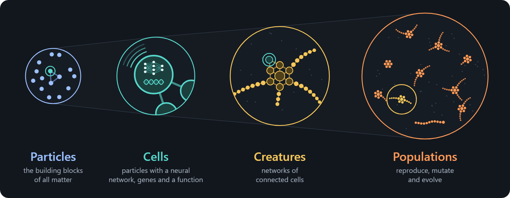

# Getting started

**ALIEN** (**A**rtificial **LI**fe **EN**vironment) is an artificial life simulator built on a GPU-accelerated 2D particle engine for soft bodies and fluids. Everything in a simulated world consists of particles. They can be bonded into solid structures, flow as liquids or act as cells with specialized functions such as sensors, muscles and constructors, each controlled by a small neural network. Networks of such cells form creatures that perceive their environment, move, feed, compete and build offspring according to their genome. With mutations enabled, populations evolve and whole ecosystems can emerge. The engine runs entirely on the graphics card and simulates worlds with millions of particles in real time.

This documentation is organized into three parts. **Start here** covers the first steps, the user interface and how to control ALIEN with AI agents. **Explore** introduces the central concepts step by step, from the physics sandbox to creature design, evolution and generative art. **Reference** documents every cell type, the genome format, the neural networks, all simulation parameters and the controls in detail. The search field above the table of contents finds any term across all chapters.

> **Tip:** Press **F1** to open or close this documentation.

## What you can do with ALIEN

ALIEN serves three main purposes:

- **Evolution simulations.** Seed a world with self-replicating creatures, switch on mutations and watch how populations adapt, compete and form ecosystems. ALIEN is used to study how complexity arises from simple building blocks. See [Evolution experiments](evolution.md).
- **Sandbox game.** Draw rocks, pour liquids and build machines or creatures, then push, throw or cut them apart with the mouse. The physics engine reacts immediately while the simulation is running. See [Sandbox and editing](sandbox.md).
- **Generative art.** Evolution and physics produce a great variety of forms. With colors, glow, force fields and painted backgrounds, ALIEN can create pictures and animated scenes. See [Generative art](generative-art.md).

> **AI agents.** ALIEN contains a built-in MCP server. An AI agent connected to it carries out tasks that you describe in plain language, for example *"Build a coral reef with swimming creatures"* or *"Find out why my population dies out"*. The agent can create worlds, design genomes, change parameters and take screenshots. See [AI agents](ai-agents.md) for the setup and example prompts.

## Your first five minutes

ALIEN starts with a simulation already loaded. Try the following steps:

1. **Run and pause.** Press **Space** to start the simulation and press it again to pause it. The **Simulation** menu offers the same commands.
2. **Look around.** Turn the mouse wheel to zoom in and out. Hold the middle mouse button and drag to move the view. Outside edit mode (see step 5), you can also hold the left mouse button to zoom in continuously and the right mouse button to zoom out.
3. **Watch closely.** Zoom in until you see individual cells. Creatures consist of connected cells. Press **Alt+O** to switch on the cell info overlay, which labels each cell with its type when you have zoomed in far enough.
4. **Open another world.** When ALIEN starts for the first time, the **Browser** window is already open, partly hidden behind this documentation window. Click it to bring it to the front. If you have closed it, press **Alt+B** to open it again. In the **Simulations** tab, the **Featured** workspace holds the simulations of the ALIEN project and the **Community** workspace holds those shared by other users. Double-click a simulation to download and open it.
5. **Interact with the world.** Press **Alt+E** or click the round button in the lower left corner to enter edit mode. While the simulation runs, choose the **Apply forces** tool in the tool bar next to the button and drag across the world to push the objects under the cursor. Press **Alt+E** again to return to navigation mode.

> **Note:** Large simulations need a powerful graphics card. If a world runs slowly, open a smaller one from the **Browser**. The **Temporal control** window (Alt+1) shows the number of time steps per second.

## Where to go next

Choose the path that matches your interest:

| If you want to... | Read |
| --- | --- |
| understand the windows and controls | [The user interface](user-interface.md) |
| control ALIEN with an AI agent | [AI agents](ai-agents.md) |
| draw, build and play with physics | [Sandbox and editing](sandbox.md) |
| learn what cells and creatures are | [How life works](how-life-works.md) |
| design a creature yourself | [Your first creature](first-creature.md) |
| run your own evolution experiment | [Evolution experiments](evolution.md) |
| create pictures and animated scenes | [Generative art](generative-art.md) |

If you run into problems, see [Troubleshooting](troubleshooting.md) or ask the community on the [ALIEN Discord server](https://discord.gg/7bjyZdXXQ2). The [YouTube channel](https://youtube.com/channel/UCtotfE3yvG0wwAZ4bDfPGYw) has many videos about ALIEN.
