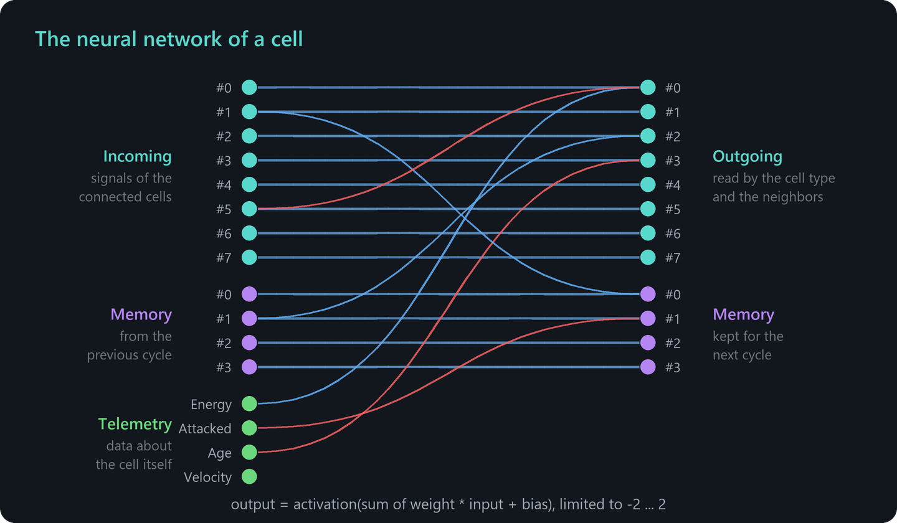

# Neural networks and signals

Every cell contains a small neural network. Together, the networks of all cells form the nervous system of a creature: they pass on what sensors perceive, combine information and control muscles and other cell types. This chapter explains how the networks compute, how signals travel and how you design networks in the genome editor.

## The cycle of a cell

Every 6 time steps, all cells execute one **cycle**:

1. **Gather inputs.** The cell collects the signals of its connected cells, its own memory values and some data about itself.
2. **Compute.** The neural network calculates 8 signal outputs and 4 memory outputs.
3. **Act.** The cell type reads its inputs from the 8 signal channels and may overwrite some of them with its results. For example, a sensor writes what it found.

The resulting signal is what the connected cells see in the next cycle. A signal therefore needs one cycle to move from one cell to the next. Across a chain of ten connections, it takes ten cycles, which is 60 time steps.



## Inputs

The network has 16 inputs:

| Inputs | Name in the editor | Meaning |
| --- | --- | --- |
| 1 to 8 | In 0 to In 7 | Channels #0 to #7 of the signals of the connected cells. For each channel, the values of all connected cells are multiplied by their **connection weight** and added up. |
| 9 to 12 | Mem 0 to Mem 3 | The memory outputs of this cell from the previous cycle. |
| 13 | Energy | The usable energy of the cell relative to the normal energy. 1 means normal energy. The value is limited to 2. |
| 14 | Attacked | 1 if the cell was attacked recently, otherwise 0. |
| 15 | Age | The age of the cell. It reaches 1 at an age of 100,000 time steps and stays there. The **Object color transition rules** expert setting resets the age to 0 each time it changes the color of the cell. |
| 16 | Velocity | The velocity of the cell multiplied by 20 and limited to 2. A velocity of 0.05 gives 1, and a velocity of 0.1 or more gives 2. |

The **connection weights** decide which neighbors a cell listens to. There is one weight for each connection, and a cell has up to six connections. By default, only the first connection has weight 1 and all others have weight 0.

## Outputs

The network has 12 outputs:

- **Outgoing** signal channels #0 to #7. They are visible to the connected cells and are used by the cell type of the cell itself.
- **Memory** values #0 to #3. They are only visible to the cell itself and serve as inputs in the next cycle. This gives a cell a state that persists over time.

Each output is calculated as

```
output = activation(sum of weight * input + bias)
```

and is then limited to the range from -2 to 2.

### Memory outputs

The memory outputs are special: they are only recalculated when the first input, which is channel #0 of the incoming signals, is greater than 0.1. Otherwise they keep their previous values. This first input acts as a gate and does not itself contribute to the memory outputs. With this gate, a creature can store a value at a certain moment, for example the direction in which it last saw food.

### Activation functions

| Function | Behavior |
| --- | --- |
| Tanh | Smooth curve between -1 and 1. Good for limiting and for soft decisions. |
| Binary step | 1 for inputs of 0.0001 or more, otherwise 0. An input of exactly 0 therefore gives 0. Good for switches. |
| Identity | Passes the value unchanged. This is the default. |
| Absolute value | Makes negative values positive. |
| Gaussian | 1 at 0 and falling towards 0 for larger values in both directions. Good for detecting whether a value is close to zero. |
| Mod | Wraps the value into the range from -1 to 1. Useful for angles. |

## The default network

A new node has a network that copies the incoming signals and the memory: each incoming channel is connected to the outgoing channel with the same number, and each memory input to the memory output with the same number, all with a weight of 1. All biases are 0 and all activation functions are *Identity*. Together with the default connection weights, a cell therefore copies the signal of the cell at its first connection.

In a gene, the first connection of each node points to the next node, and the first connection of the last node points to the constructor that built it. As a result, signals flow through a gene from the last node towards node 0. This is why sensors belong at the end of a gene and muscles closer to node 0. With **Separation**, the last node is not connected to the constructor, and its first connection points to the node before it instead. With several concatenations, the first connection of the last node of a copy points to node 0 of the next copy. This applies to every copy except the last one.

When you add a node at the end of a gene, the genome editor sets the first connection weight of the new last node to 0 and that of the previous last node to 1. This way, the last node does not listen to its constructor. The single node of a new gene keeps the weight 1, and removing or moving nodes does not change any weights. After such edits, check the connection weights of the last node.

## Signal channels and cell types

The channels have no fixed meaning by themselves. They get their meaning from the cell types that read and write them. Most cell types use channel #0 as their trigger or strength. The following channels are written by cell types:

| Channel | Written by |
| --- | --- |
| #0 | Sensor (found), Generator (value) |
| #1 | Sensor (angle), Injector (success), Communicator receiver (angle) |
| #2 | Sensor (mass), Attacker (success), Reconnector (success) |
| #3 | Sensor (distance) |
| #4 | Constructor (success) |

Memory cells and communicators can write all channels. The complete list is in [Cell types](cell-types.md#how-cell-types-work).

## The neural network editor

Select a node in the genome editor. The middle column shows its neural network as a graph:

- The inputs are on the left, grouped into **INCOMING** (inputs 1 to 8), **MEMORY** (inputs 9 to 12) and **TELEMETRY** (inputs 13 to 16). The outputs are on the right, grouped into **OUTGOING** with **Out 0** to **Out 7** and **MEMORY** with **Mem 0** to **Mem 3**.
- Lines connect inputs and outputs. Blue lines are positive weights, red lines negative weights. The thicker a line, the larger the weight.
- A small marker next to each output shows its bias.
- Next to the outgoing channels, the editor shows which channels the cell type of the node reads and writes, for example *trigger*, *found* or *angle*.
- Click an input and an output to select the connection between them. A card shows the **Weight** of the connection, the **Bias** of the output and buttons for the **activation function** of the output.
- Above the graph, the **Connection weights** set how strongly the cell listens to each of its connections. The sliders are numbered 1 to 6 and range from -1 to 1.

The preview of the genome editor can show a **neural activity editor**. It needs the detailed simulation of the preview, which is off by default. Only the detailed simulation calculates signals. Click the button with the dice icon below the preview to switch the detailed simulation on, then click a cell in the preview to select it. The neural activity editor shows the signal channels and memory values of this cell. You can change them by hand and watch how the creature reacts.

A signal value that you set by hand lasts only until the next cycle. In that cycle, the cells that listen to the edited cell read it once, while the edited cell replaces it with the output of its own network. The value therefore moves through the creature as a short pulse, and the cell type of the edited cell itself does not react to it. Memory values that you set stay as long as the memory gate of the cell is closed. For a lasting input, give the outgoing channel a bias in the neural network editor.

## Examples

**Flee instead of approach.** A creature with a sensor and muscles in *Direct movement* mode moves towards what the sensor detects. In the first muscle cell that receives the sensor signal, select the connection from incoming #1 to outgoing #1, set the **Bias** to 1 and the activation function to *Mod*. Adding 1 turns the direction by 180 degrees, and *Mod* wraps the result back into the valid range. The creature now flees from what it sees.

**A constant signal.** To activate muscles permanently, select the last node of the gene, set all its connection weights to 0 and give outgoing #0 a bias of 1. The cell outputs 1 in channel #0, and all cells closer to node 0 copy this value. This works only if the cell type of the last node does not write channel #0 itself, as with a base cell or a muscle. A sensor or a generator, for example, changes channel #0 in every cycle. See [Signal channels and cell types](#signal-channels-and-cell-types) for all cell types that write channel #0.

**Store and release energy.** In a depot cell, set the weight from incoming #0 to outgoing #0 to 0, set the weight from the **Energy** telemetry input to outgoing #0 to 1 and set the bias of outgoing #0 to -1. The output is then 0.1 or more when the usable energy of the cell is at least 10 percent above its normal energy, so the depot stores the surplus. It is -0.1 or less when the usable energy is at least 10 percent below normal, so the depot releases its stored energy. In between, the depot does nothing. The cells that listen to the depot now receive this value in channel #0 instead of the signal that reached the depot.

**Remember the last direction.** In the node directly before a sensor, whose first connection points to the sensor, set the weight from memory #0 to memory #0 to 0 and the weight from incoming #1 to memory #0 to 1. Channel #0 of the sensor is 1 whenever something is found, so the memory gate opens only then and memory #0 takes over the current direction. When the target disappears, the gate closes and memory #0 keeps the last known direction. Finally, set the weight from incoming #1 to outgoing #1 to 0 and the weight from memory #0 to outgoing #1 to 1, so that the cell passes on the remembered direction instead of the current one.

## Watching signals

- When you zoom in, cells light up to show their channel #0 and whether they are attacked. With [hardware ray tracing](generative-art.md#ray-tracing), which is on by default on GPUs that support it, the small body in the middle of each cell and its dendrites glow brighter the higher the positive value of channel #0, and strongly while the cell is attacked. Without ray tracing, cells flash briefly when their channel #0 changes strongly or while they are attacked.
- In the preview of the genome editor, cells flash when their channel #0 changes strongly, but only with the detailed simulation.
- The **inspection window** of a cell (Alt+N in edit mode) shows the current values of its signal channels and memory.
- The [Cell info overlay](user-interface.md#menus) (Alt+O) labels the cells with their types when you zoom in far enough.
