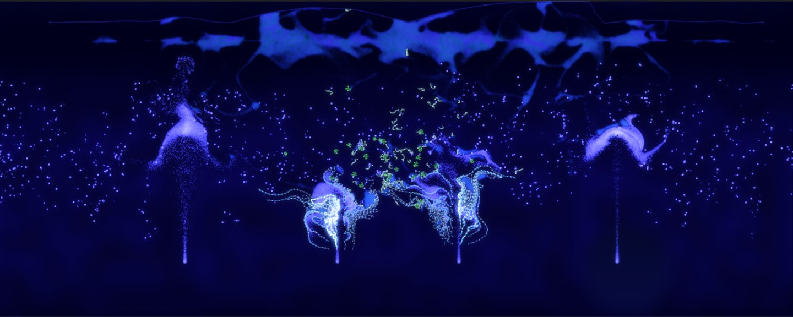

# Sandbox and editing

ALIEN can also be used as a physics sandbox. You can draw rocks and liquids, build structures, cut them apart, throw them at each other and watch how everything reacts. This chapter introduces the materials of the world and the editing tools. No knowledge of creatures is needed.

## Materials

Matter in the world consists of small round particles called **objects**. There are four kinds of objects, plus energy particles:

| Material | Description |
| --- | --- |
| **Solid** | Particles that are connected to each other and form elastic bodies such as rocks, walls or machines. Connections break when the force becomes too large. Solids block the view of sensor cells. |
| **Fluid** | Particles without connections that flow like a liquid or a gas. Fluids can glow. |
| **Free cell** | Organic matter without a genome. Free cells serve as food for creatures and decay when their energy is too low. |
| **Cell** | The building block of creatures. Cells have a genome, a small neural network and a cell type. They are not drawn by hand but grow from seeds, as described in [Your first creature](first-creature.md). |
| **Energy particle** | Free energy that drifts through the world. Cells and free cells absorb energy particles on contact, but solids and fluids do not. |

Every object has a few basic properties:

- **Color.** One of ten customization colors. Many simulation parameters can be set per color, so the color also affects how an object behaves. For example, solids of one color can be made more fragile than those of another color.
- **Energy.** The energy of an object also determines its brightness.
- **Stiffness.** How strongly the object resists the deformation of its connections.
- **Static.** Static objects are not affected by forces, never age and never decay. They keep their current velocity, so they stay in place only if their velocity is zero. Use them for walls and anchors.
- **Sticky.** Sticky objects form new connections when they collide with other objects. It is enough if one of the two objects is sticky. The collision must be at least as fast as the **Fusion velocity** parameter, and both objects need a free connection slot. Fluids and static objects never connect this way.

## Entering edit mode

Press **Alt+E** or click the round button in the lower left corner. A tool bar appears next to the button. Most tools show a small card above the tool bar with their options and a hint on how to use them. Press **Alt+E** again to return to navigation mode.

## Creating matter

Choose one of the creation tools in the tool bar:

| Tool | How to use it |
| --- | --- |
| **Draw freehand** | Hold the left mouse button and paint. The **Pencil radius** sets the width of the stroke. |
| **Single object** | Left click to place one object or energy particle. |
| **Rectangular object network** | Left click to place a rectangle of connected objects. |
| **Hexagonal object network** | Left click to place a hexagon, built from layers around the center. |
| **Disc-shaped object network** | Left click to place a disc. An **Inner radius** greater than 0, such as the default of 5, creates a ring. |
| **Object network along a line** | Left click to add points, right click to remove the last point, **Enter** to finish, **Esc** to abort. |
| **Object network along a Bezier curve** | Like the line tool, but the points define a smooth curve. |
| **Polygon-shaped object network** | Like the line tool, but the points define the outline of a filled polygon. |

The option card of each tool sets the **Color**, the **Material** and the **Energy** of the new objects. Depending on the tool and the material, it also shows further settings: the size of the shape, the **Object distance** between neighboring objects, the **Stiffness** of solids and free cells, the **Glow** of fluids and the **Sticky** and **Static** checkboxes. With *Energy particles* as the material, the tools create free energy instead of matter.

> **Tip:** The **Image converter** (Alt+Y or the **Pattern from image** button) turns an image file into a pattern of connected solid objects. Every pixel that is not almost black becomes one object, in the customization color that best matches its hue and saturation. The pattern appears in the middle of the view and is selected. This is a quick way to bring logos or drawings into a world.

## Selecting and moving

With the **Select and move** tool:

- **Click** an object to select it. Hold **Ctrl** while clicking to add objects to the selection or to remove them.
- **Drag with the right mouse button** to select all objects inside a rectangle.
- **Drag with the left mouse button** to move the selection. If the simulation is running, the selection follows the mouse and keeps its momentum when you release it, so you can throw objects.
- **Drag the round handle** above the selection frame to rotate the selection.
- Press **Esc** to deselect.

Two buttons in the tool bar set the scope of most edits, such as moving, rotating, coloring, copying and deleting. **Apply to selected objects** affects only the selected objects, so when they are moved, their connections to unselected objects may break. **Apply to entire networks** affects the complete networks that the selected objects belong to. This is the default. Holding **Shift** temporarily switches between the two. A third button, **Glue on contact**, connects moved or rotated objects to the objects they touch when it is switched on. While the simulation is running, dragging always moves the entire networks of the selected objects and ignores **Glue on contact**. The dragged objects pass through other objects until you release them.

## The action bar of a selection

When the **Select and move** tool is active, a small action bar appears above the selection:

- **Color**, **Stickiness** and **Static** change these properties for all selected objects.
- **Make uniform velocities** gives all selected objects the same velocity, so that they move as one block.
- **Release stresses** sets the rest length of each connection and the reference angles between neighboring connections to their current values, which removes tension and bending stress.
- **Glue selection** connects neighboring objects inside the selection.
- **Multiply** creates copies of the selection, either in a grid or at random positions in the whole world. It always copies the entire networks, even with **Apply to selected objects**.
- **Copy** (Ctrl+C) copies the selected objects and **Delete** (Del) removes them. **Paste** (Ctrl+V or the **Paste** button in the tool bar) inserts the copy in the middle of the view and selects it, so you can drag it into place.
- **Inspect** opens inspection windows for the selected objects or creatures, or opens the genomes of the selected creatures in the genome editor.
- **Transform** sets position, velocity, rotation angle and angular velocity numerically.

## Cutting and pushing

- **Scissors.** Hold the left mouse button and drag across connections to cut them. With **Only in selection**, only connections between selected objects are cut.
- **Apply forces.** Hold the left mouse button and drag to push everything under the cursor in the direction of the movement. This tool works only while the simulation is running.

## Inspecting and changing individual objects

Select one or more objects and press **Alt+N**, or use **Inspect** in the action bar. An inspection window opens for each object. At most 20 inspection windows can be open at the same time. If a selection would exceed this limit, no window opens and a message appears instead. The window shows the properties of the object and lets you change most of them, for example its position, velocity, energy, color and whether it is static or sticky. For cells, you can also change the cell type and the neural network. The connections, the object id and the creature id are only displayed. **Esc** closes all inspection windows.

## Mass operations

**Tools > Mass operations** (Alt+H) changes many objects at once. It can randomize the colors of objects and genomes, choosing among the checked colors. It can also randomize energies, ages, the countdowns of detonator cells and the glow of fluids within chosen ranges. Further options give the creatures new random lineage ids and set the mutation rates of the genomes to fixed values. Each creature and each connected network gets its own random value. This is useful for creating variation between them, for example different shades among separate rocks or different colors in a population. With **Restrict to selection**, only the selected objects and the networks and creatures they belong to are changed.

## Basic physics

A few simulation parameters determine how matter behaves. They are set in the **Simulation parameters** window (Alt+4), which is described in [Simulation parameters](simulation-parameters.md):

- **Friction** slows down the motion of objects, but not of energy particles. Without friction, objects keep moving forever.
- **Maximum force** and **Maximum distance** decide when connections break. If the force on an object exceeds the maximum force, the object loses all its connections with a certain probability per time step. A connection that is stretched beyond the maximum distance breaks. Low values make solids fragile.
- **Rigidity of solids** makes connected solids move more like rigid bodies.
- **Pressure**, **Viscosity** and **Smoothing length** control how neighboring objects push each other apart and even out their velocities. They shape the flow of fluids, but they also act when solids, free cells and cells collide.
- There is no gravity by default. A **layer** with a linear force field adds gravity, wind or currents to the whole world or to a part of it. To add one, click the **Add parameter layer** button in the tool bar of the **Simulation parameters** window, tick the checkbox in front of **Field type** and choose *Linear*.

> **Tip:** Create a flashback in the **Temporal control** window before an experiment. **Load flashback** restores the saved world, so an experiment can be repeated as often as needed. Changes to simulation parameters such as **Friction** are not undone.
