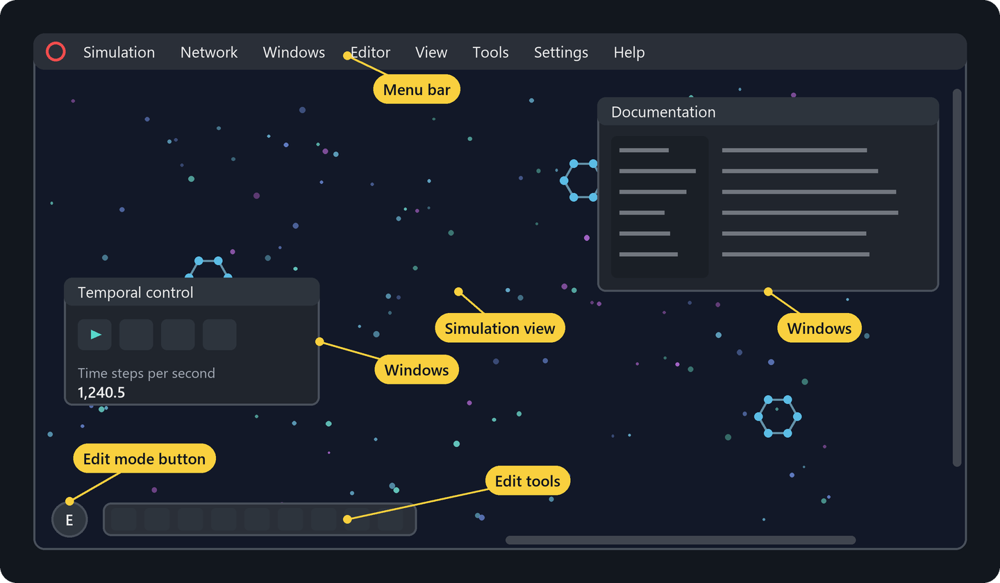

# The user interface

This chapter describes the screen of ALIEN. The first sections cover everything you need for daily use. The later sections explain each window and dialog in more detail and serve as a reference.

## The main screen

The screen consists of a few main parts:

- **Menu bar.** It runs along the top edge and gives access to most functions. The power button at its left end closes ALIEN. While a simulation from the browser is open, its name, its author and a heart appear at the right end.
- **Simulation view.** The world fills the whole screen behind all windows. Scrollbars at the right and bottom edges show which part of the world is visible.
- **Edit mode button.** The round button in the lower left corner switches between navigation mode and edit mode. In edit mode, a tool bar with editing tools appears next to the button.
- **Windows.** Windows float above the simulation view. You can move them by their title bar, resize them at their edges and collapse or close them with the buttons in the title bar. All windows can be opened again from the menus. The only exceptions are the separate parameter windows created with **Open in new window**, which are opened again from the **Simulation parameters** window.

Short messages such as *Run* or *Copied to clipboard* appear briefly in the lower part of the screen. They can be switched off under **View > Message overlay** (Alt+X).

> **Tip:** Most buttons show a tooltip when you hover the mouse over them. Properties and parameters usually have a small question mark icon after their name. Hover the mouse over this icon to read an explanation.

## Navigating the world

In navigation mode, the mouse controls the view:

| Action | Mouse |
| --- | --- |
| Zoom in or out | Turn the mouse wheel |
| Zoom in continuously | Hold the left mouse button |
| Zoom out continuously | Hold the right mouse button |
| Move the view | Hold the middle mouse button and drag |

The **Spatial control** window (Alt+2) shows the world size, the zoom factor and the center of the view. It has buttons to zoom in and out, to center the view and to change the world size. While the simulation is running, the **Autotracking on selection** option keeps the selected objects in the middle of the view, which is useful for following a creature.

The world has no edges. Objects that leave it on one side come back on the opposite side, as if the world were wrapped around a doughnut. The **Borderless rendering** simulation parameter draws the world repeatedly so that the wrap-around becomes visible.

## Running the simulation

Press **Space** to run or pause the simulation. The **Temporal control** window (Alt+1) offers further functions:

- **Run** and **Pause** start and stop the simulation.
- **Process single time step** calculates exactly one time step while the simulation is paused. **Load previous time step** undoes it. This is useful for examining what happens in detail.
- **Create flashback** stores the current world in memory and **Load flashback** returns to it later. There is only one flashback, and a new one replaces the previous one. **Load flashback** does not restore the simulation parameters, except for the **External energy amount** and the positions of layers and radiation sources that move. Create a flashback before you try something risky with the objects of the world.
- **Time steps per second** shows the current speed. **Slow down** limits the speed, for example to watch fast events.
- **Sync with rendering** couples the number of time steps to the number of rendered frames. This gives smooth motion at the cost of speed.

## Edit mode

In edit mode you can select, move, create and change objects. Enter it with **Alt+E** or the round button in the lower left corner. The tool bar next to the button contains:

- **Select and move.** Click an object to select it. Hold **Ctrl** while clicking to add objects to the selection or to remove them. Drag a rectangle with the right mouse button to select all objects inside it. Drag the selection with the left mouse button to move it. While the simulation runs, you can also throw it. A frame with a rotation handle and a small action bar appears around the selection.
- **Apply forces.** Drag across the world to push the objects under the cursor. This tool works only while the simulation is running.
- **Scissors.** Drag across connections to cut them.
- **Draw freehand** and the shape tools for single objects, rectangles, hexagons, discs, lines, Bezier curves and polygons. They create new matter.
- **MCP server** opens or closes the **MCP server** window. **Pattern from image** asks for an image file and turns it into a pattern in the middle of the view. **Paste** inserts the copied selection in the middle of the view.
- **Apply to selected objects** and **Apply to entire networks** decide whether edits such as moving, rotating, coloring, copying or deleting affect only the selected objects or the entire networks of connected objects they belong to. By default, edits apply to entire networks. Hold **Shift** to switch to the other choice temporarily. While the simulation runs, dragging and throwing always move entire networks.
- **Glue on contact**, when switched on, connects moved or rotated objects to the objects they touch.

The [Sandbox and editing](sandbox.md) chapter explains these tools in detail.

## Menus

| Menu | Contents |
| --- | --- |
| **Simulation** | New (Ctrl+N), Open (Ctrl+O), Save (Ctrl+S), Save picture, Run and Pause (Space) |
| **Network** | Browser (Alt+B), Login (Alt+L), Logout, Upload simulation (Alt+D), Upload genome (Alt+Q), Delete user |
| **Windows** | Temporal control (Alt+1), Spatial control (Alt+2), Evolution dashboard (Alt+3), Simulation parameters (Alt+4), Autosave (Alt+5), MCP server (Alt+6), Log (Alt+7) |
| **Editor** | Genome editor (Alt+W), Allow object editing (Alt+E), Inspect objects (Alt+N), Inspect genomes (Alt+F), Inspect creatures (Alt+P), Close inspections and Deselect (Esc), Copy (Ctrl+C), Paste (Ctrl+V), Delete (Del) |
| **View** | Cell info overlay (Alt+O), Message overlay (Alt+X), Render UI (Alt+U), Render simulation (Alt+I), Console mode (Alt+C) |
| **Tools** | Mass operations (Alt+H), Image converter (Alt+Y), Recorder (Alt+V) |
| **Settings** | Save on exit, Dark mode, Display settings, Network settings, Debug mode |
| **Help** | About, Documentation (F1), Privacy policy |

Press **F7** to switch between window mode and full screen at the desktop resolution. All shortcuts are listed in [Keyboard and mouse](keyboard-and-mouse.md).

## Windows

### Temporal control

Runs, pauses and steps the simulation, manages the flashback and shows the speed. ALIEN also creates a flashback automatically after a simulation is created, opened or downloaded, after the world is resized and after an AI agent applies mass operations to the whole world. See [Running the simulation](#running-the-simulation).

### Spatial control

Shows the world size, the zoom factor and the view center, and offers zoom buttons, autotracking and the zoom sensitivity. The **Resize** button changes the size of the world. See [Navigating the world](#navigating-the-world).

### Evolution dashboard

Shows the state of the world at a glance: cards with the numbers of solids, fluids, cells, free cells, energy particles, creatures and lineages as well as the internal and external energy. Below them, a table lists the lineages, which are groups of related creatures. It can be filtered by color. Each lineage has a button that opens the genome of a representative creature in the genome editor.

At the bottom of the window, plots show how the number of creatures, the average numbers of cells and genome nodes, the average generation, the average mutation rate and the energy stored in the creatures develop over time. Four further plots show rates per 1,000 time steps: the number of created creatures, how much the genomes change through mutations, the energy gained by attacks and the muscle activity. The last two are averages per creature. The plots cover either the last time steps or the entire history. If no lineage is selected in the table, they show one curve for all lineages that pass the color filter. Otherwise, each selected lineage gets a curve of its own. The dashboard is the main tool for [evolution experiments](evolution.md).

### Simulation parameters

All rules of the world, such as friction, the energy of cells or the strength of attacks, are simulation parameters. The window shows the **base parameters**, which apply everywhere, plus up to 20 **layers** and up to 40 **radiation sources**. A layer overrides parameters in a part of the world and can exert a force field. A radiation source emits energy particles. The filter field finds parameters by name. See [Simulation parameters](simulation-parameters.md).

### Autosave

Lists the save points stored in the chosen directory. The download button in a row loads that save point. You can also create and delete save points by hand.

Automatic save points are off by default. To switch them on, tick the checkbox in front of **Autosave interval (min)** in the **Settings** section. ALIEN then creates a save point at this interval. The interval counts minutes of real time, so save points are also created while the simulation is paused. **Directory** sets where the save points are stored. In the default *Limited save files* mode, **Number of files** sets how many save points are kept. Each new save point, including one created by hand, deletes the oldest ones beyond this number. In *Unlimited save files* mode, all save points are kept.

### MCP server

Starts and stops the built-in server for AI agents, shows the address to connect to and logs every command an agent sends. See [AI agents](ai-agents.md).

### Log

Shows the messages that ALIEN writes, for example when a simulation is loaded. The **Verbose** option shows more details. The same messages are written to the file *log.txt* next to the program.

### Genome editor

Designs and edits genomes, the blueprints of creatures. It shows the genome on the left and the properties of the selected gene or node in the middle. On the right, the **Phenotype** tab shows a live preview of the resulting creature, and the **Gene network** tab shows which genes build which and highlights genes with warnings. See [Your first creature](first-creature.md) and [Genomes and construction](genomes.md).

### Inspection windows

In edit mode, select objects and press **Alt+N** to open an inspection window for each of them. At most 20 inspection windows can be open at the same time. If objects and energy particles are selected together, only the objects get a window. Each window shows all properties: position, velocity, energy, connections, the cell type with its settings and the neural network. Most of them can be edited, but the object id, the connections and almost all creature values, such as the generation, are only displayed. **Alt+P** shows the creature of a selected cell and **Alt+F** opens the genome of that creature in the genome editor. **Esc** closes all inspection windows.

### Browser

Lists the simulations and genomes on the ALIEN server. The tabs switch between **Simulations** and **Genomes**. The **Featured** workspace contains the simulations of the ALIEN project, **Community** those shared by users and **Private** your own uploads. You can switch between a gallery view with preview pictures and a table view with folders. Double-click an entry to open it. Anyone can give an entry a heart. After logging in, you can also upload your own work. See [Files and command line](files.md#sharing-in-the-browser).

### Recorder

Flies the camera along waypoints and records the flight as a video. **Add waypoint** adds a waypoint with the center and zoom of the current view. It is inserted after the selected waypoint, or at the end if none is selected. In the table, the **Duration** of a waypoint is the time in seconds that the camera needs to get there from the previous waypoint. The path between the waypoints is smoothed. **Smoothing** sets how much it cuts the corners, but the first and the last waypoint are always reached. **Play** flies the path in real time. With **Run simulation during flight**, a paused simulation runs during **Play** and **Record video** and is paused again at the end. Without it, a paused simulation stays paused. **Save camera flight** stores the waypoints and the settings in a *.flight.json* file. **Open camera flight** loads them again.

**Record video** writes an MP4 file at the chosen frame rate. The video shows the simulation without the user interface at the size of the view, so full screen mode (F7) gives a large video. The recording continues while ALIEN is minimized, which happens in full screen mode when you switch to another program. On Linux, ffmpeg needs to be installed.

The **Time-lapse** of a waypoint speeds up the simulation in the video, but the camera moves as fast as without time-lapse. At 1x, the simulation in the video runs with the **Time steps per second at 1x** from the settings, at 10x with ten times as many. The time-lapse changes smoothly on the way to the next waypoint, so a video can start at normal speed and become faster and faster. Between two frames, ALIEN calculates exactly the time steps the video needs, so the video runs smoothly even if the recording takes longer than the video lasts.

During the flight, the view and the video show the current time-lapse as *temporal* factor and the zoom as *spatial* factor in the lower right corner, for example *temporal: 2.5x*. Switch off **Show time-lapse and zoom** to hide them. The message overlay shows *Playing...* during **Play** and *Recording...* during a recording. It does not appear in the video. **Stop** ends a recording early and keeps the frames recorded so far.

## Dialogs

- **New simulation** (Ctrl+N) creates an empty world with a given width and height. **Energy** fills the external energy pool. With **Adopt parameters**, the simulation parameters of the current simulation are kept.
- **Save picture** renders the current view as a PNG file with the width and height you enter. The picture can be much larger than the screen, but the graphics card limits its maximum size.
- **Mass operations** (Alt+H) randomizes properties such as energy, age or color of many objects at once.
- **Image converter** (Alt+Y) turns an image file into a pattern of solid objects.
- **Display settings** sets full screen mode, resolution, frame rate and the scaling of the user interface.
- **Network settings** sets the server address. **Count me as active** decides whether ALIEN is counted among the active simulators shown in the **Browser**.

## Console mode

**View > Console mode** (Alt+C) hides the user interface and switches off the rendering, so that a running simulation gets the full power of the graphics card. This is useful for long runs. **Slow down** and **Sync with rendering** are switched off until you return. A paused simulation stays paused, so start it before you switch. The console window shows the time step, the time steps per second and the numbers of cells, creatures and lineages. Press **Esc** to return to the user interface. Press **Q** or **Ctrl+C** to quit ALIEN, which saves the simulation if **Save on exit** is switched on. Console mode is not available while a video is recorded.
